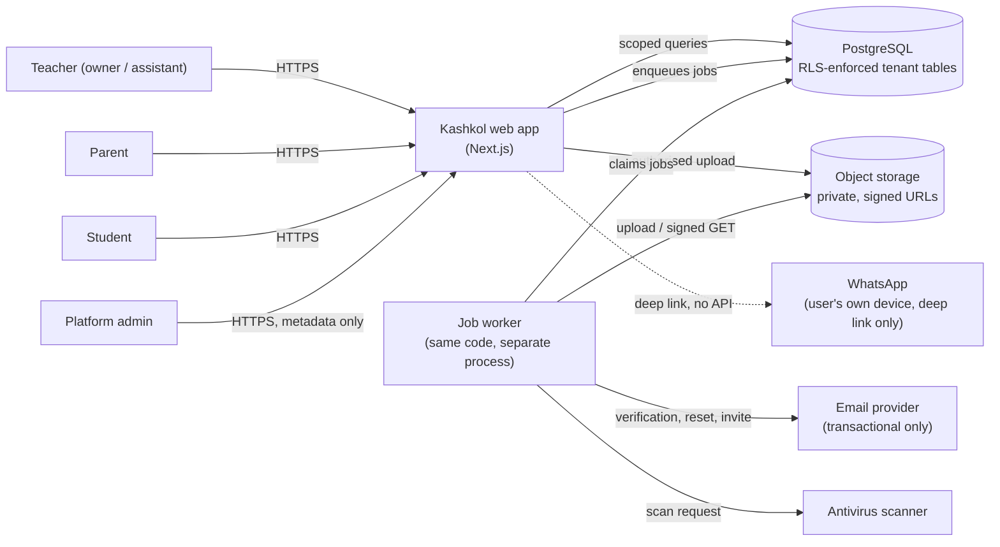
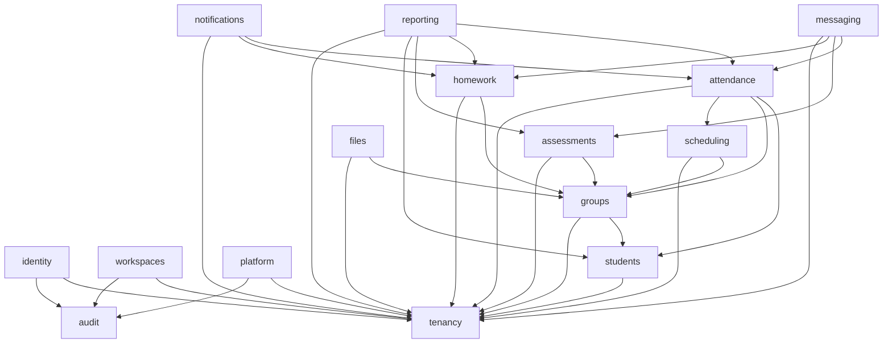
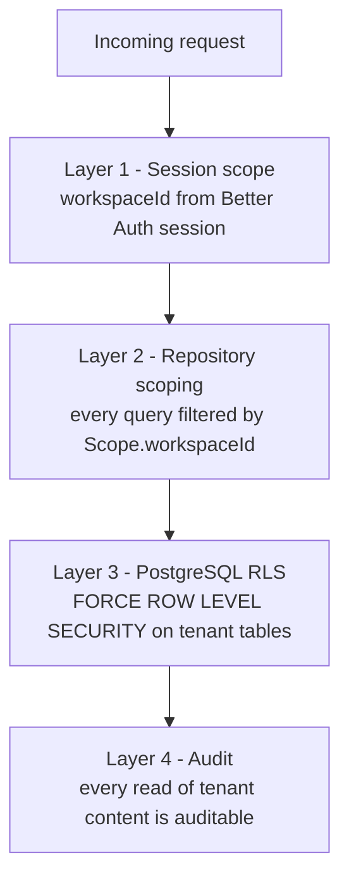
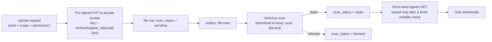

# Kashkol — Architecture

**Status:** Draft v0.1 · **Date:** 2026-10-21 · **Owner:** Engineering
**Companions:** `PRODUCT_REQUIREMENTS.md`, `USER_FLOWS.md`, `RELEASE_PLAN.md`, `OPEN_QUESTIONS_AND_ASSUMPTIONS.md`
**Companion documents:** `DATA_MODEL.md`, `SECURITY_AND_PRIVACY.md`, `INTEGRATIONS.md`, `decisions/`

> This document defines **how Kashkol is built**, not what it does. What it does is specified in
> `PRODUCT_REQUIREMENTS.md` and `USER_FLOWS.md`; this document must not contradict either. Where this
> document makes a choice the requirements leave open, the choice is recorded in `decisions/` and
> cross-referenced here. Where it defers to an open question, the `OQ-n` marker appears inline.

---

## 1. Purpose and scope

### 1.1 What this document decides

| Topic | Section |
|---|---|
| Runtime, framework, and pinned dependency versions | §3 |
| System context and deployment topology | §4, §5 |
| Module decomposition and dependency rules | §6, §7 |
| Request lifecycle: auth → scope → authorise → validate → transact → audit | §8 |
| Tenant isolation enforcement | §9 |
| Authorisation and permission model | §10 |
| Data access layer | §11 |
| Validation and error contract | §12 |
| Audit and derived state | §13, §14 |
| Background work, outbox, and retries | §15 |
| File storage pipeline | §16 |
| Notifications | §17 |
| i18n, RTL, and theming | §18 |
| Observability, health, and PII redaction | §19 |
| Testing strategy and the isolation matrix | §20 |
| Migration policy | §21 |
| Deployment, flags, and rollback | §22 |
| Performance budgets | §23 |
| Milestone mapping | §24 |
| Architecture risks | §25 |

### 1.2 What this document explicitly does not do

- It does **not** implement any business feature. No feature code is written at this stage.
- It does **not** re-specify product behaviour; where it gives an example it cites the requirement.
- It does **not** replace the legal review required by `F-P0-08` AC-7 and `RELEASE_PLAN.md` §9.

### 1.3 How to read it

Every architectural rule in this document is stated as a **rule** that can be checked mechanically or
by review. Rules marked **[CI]** must be enforced by an automated check that fails the build.
Rules marked **[TEST]** must be covered by a named automated test.

---

## 2. Architectural drivers

These are the constraints the architecture exists to satisfy. Each is traceable to a requirement.

| # | Driver | Source | Architectural consequence |
|---|---|---|---|
| AD-1 | Tenant isolation is a release blocker, not a feature | `F-P0-01`, `R-01`, `NF-9` | Isolation is enforced in the data layer (RLS + repository scoping), never in UI code. §9 |
| AD-2 | Every derived number is computed from records | `D-05`, `D-08`, `NF-1`, `R-02` | No stored aggregates. §14 |
| AD-3 | Every state label is truthful | `NF-2`, `NF-5`, `D-16` | Provider integrations expose only what they can observe. §16, `INTEGRATIONS.md` |
| AD-4 | History is never destroyed | `D-10`, `NF-13`, flow invariant 5 | Append-only revisions; archive/void instead of delete. §13, `DATA_MODEL.md` |
| AD-5 | Every mutation is audited server-side, in the same transaction | `NF-7`, `F-P0-07` | Audit writes are part of the transaction, not a side effect. §13 |
| AD-6 | Arabic/RTL is the default; English is fully supported | `D-01`, `F-P0-03` | Locale in the URL, direction from the locale, CSS logical properties only. §18 |
| AD-7 | Light and dark both ship with a real toggle | `D-02`, `A-13`, `DEF-13` | Token-driven theming applied before first paint. §18 |
| AD-8 | P1 has no outbound network call except transactional auth email | `PRODUCT_REQUIREMENTS.md` §4 rule 2 | Integrations are abstracted and individually feature-flagged; the P1 build links no messaging SDK. §16, `INTEGRATIONS.md` |
| AD-9 | Mobile is first-class, 320 px, RTL, both themes | `F-P1-15`, `R-05` | Server Components by default, small client islands, no layout-affecting physical properties. §6, §18 |
| AD-10 | No placeholder behaviour may ship | `NF-11`, `NF-4`, `NF-6` | Inert controls are impossible: every visible control maps to a route + permission + handler. §10, §20 |
| AD-11 | The provider surface must be small enough for a small team | `OQ-01`, `PR-1` | Modular monolith, one deployable unit, no service mesh, no cache tier. §6, `decisions/0013` |
| AD-12 | Legal review of minors' data gates M2, not M0 | `RELEASE_PLAN.md` §9 | P0/P1 data model minimises collection; portals are isolated behind an interface so they can slip. §24 |

---

## 3. Stack

### 3.1 Pinned versions

Versions below were resolved from official package registries and vendor documentation on
**2026-10-21** and are the starting pins for M0. **Exact versions are committed to the lockfile**;
ranges are used only in `package.json` for patch-level updates.

| Package | Version | Why this version | Verified against |
|---|---|---|---|
| `next` | `16.4.2` | Current stable App Router release. Turbopack is the default bundler; `middleware.ts` is renamed `proxy.ts`; async request APIs are mandatory. | `nextjs.org/docs/app/guides/upgrading/version-16` |
| `react`, `react-dom` | `19.2` | The React version the Next 16 App Router ships against (React 19.2 features: `useEffectEvent`, `<Activity>`, View Transitions). | Same guide, "React 19.2" |
| `typescript` | `5.9.x` | Minimum 5.4 for Prisma 7, recommended 5.9 by the Prisma 7 upgrade guide. | `prisma.io/docs/guides/upgrade-prisma-orm/v7` |
| `node` | `24.x` (LTS) | Prisma 7 requires Node ≥ 20.19; Next 16 requires ≥ 20.9. Node 24 is the current LTS line (`24.22.1`). | `nodejs.org/en/about/previous-releases` |
| `prisma`, `@prisma/client` | `7.10.1` | **Do not use `prisma@latest`** — it currently resolves to the Prisma 8 release candidate. Prisma 7 is the stable line. | `prisma.io/docs/orm/release-status`, upgrade guide |
| `@prisma/adapter-pg` | `7.10.1` | Prisma 7 requires a driver adapter for every database; `PrismaPg` is the PostgreSQL adapter. | Prisma 7 upgrade guide |
| `better-auth` | `1.7.12` | Stable, actively maintained, Prisma 7 compatible, ships the organization/roles plugin. | `better-auth.com/docs/adapters/prisma` |
| `@better-auth/prisma-adapter` | `1.7.12` | Official Prisma adapter; peer range includes Prisma Client `^5 \|\| ^6 \|\| ^7`. | `better-auth.com/docs/adapters/prisma` |
| `tailwindcss` | `4.3.3` | CSS-first token engine; `@import "tailwindcss"` replaces the v3 config file. | `tailwindcss.com/docs/installation/framework-guides/nextjs` |
| `@tailwindcss/postcss` | `4.3.3` | Required PostCSS plugin for Tailwind v4 in Next.js. | Same |
| `radix-ui` | `1.8.1` | The unified Radix primitive package that shadcn/ui is built on. | `ui.shadcn.com/docs/tailwind-v4` |
| `next-intl` | `4.14.9` | URL-prefixed locale routing with typed message catalogues; required by `F-P0-03`. | `next-intl.dev` |
| `zod` | `4.6.7` | One schema per input, shared by the server action and the form. | `zod.dev` |
| `vitest` | `5.0.5` | Unit and integration runner; native TS, no separate config transform. | `vitest.dev` |
| `@aws-sdk/client-s3` | `3.1155.0` | S3-compatible object storage client for signed URLs and uploads. | npm registry |

**Version pinning rules**

1. The lockfile is committed. `npm ci` is used in CI and in every deploy.
2. `prisma` is pinned to `7.10.1` and **must not** be upgraded to 8 without an ADR and a
   stabilisation check of the Prisma 8 release status page.
3. Prisma 7 is **ESM-only**. `package.json` sets `"type": "module"`, `tsconfig.json` uses
   `"module": "ESNext"`, `"moduleResolution": "bundler"`, `"target": "ES2023"`.
4. Prisma 7 does **not** load `.env` automatically; `prisma.config.ts` imports `dotenv/config`.
5. Prisma 7 removed `prisma.$use` middleware. Client **extensions** (`$extends`) are the replacement
   and are used where a query hook is genuinely needed.
6. Prisma 7 no longer auto-runs `generate` or `seed`. CI runs `prisma generate` explicitly, and
   seeding runs via `prisma db seed`.
7. Next.js 16 removed `next lint`. Linting runs through the ESLint CLI directly and is **not**
   part of `next build`. Lint therefore has its own CI job. **[CI]**
8. `middleware.ts` is renamed `proxy.ts` and runs on the Node.js runtime only.

**Packages deliberately left unpinned** (selected during M0 implementation, version recorded in an
ADR when chosen): email delivery client, PDF/XLSX parsing and writing, antivirus scanner client,
structured logger, error-tracking SDK, Playwright + axe, and the job-runner scheduler.

### 3.2 Why this stack and not the alternatives

| Choice | Rejected alternative | Reason |
|---|---|---|
| Next.js 16 App Router | SPA (React Router/Vite) + separate API server | Two deployables, two auth surfaces, and a client bundle that must hold tenant logic. The App Router keeps the tenant boundary server-side by default. |
| PostgreSQL + Prisma 7 | MongoDB, SQLite | `A-01` requires enforced row-level tenancy; only a relational DB gives RLS. SQLite has no RLS. |
| Prisma 7 | Prisma 8 (RC), Drizzle, raw SQL | Prisma 8 is a release candidate with changing APIs. Drizzle is fine but Prisma 7 is stable, has a mature migration story, and is supported by Better Auth's adapter. |
| Better Auth | Auth.js v5, Auth.js v4, hand-rolled sessions | Auth.js v5 is still `5.0.0-beta.x`. Auth.js v4 is LTS but predates the organization plugin and current Next 16 support. Hand-rolling sessions for a product holding minors' data is not defensible. |
| Tailwind v4 + shadcn/ui + Radix | Tailwind v3, hand-rolled components | v4 is CSS-first and fits the token system in `PRODUCT_REQUIREMENTS.md` §2.1 directly. Radix provides the accessible primitives `F-P0-05` requires without inventing focus-trap behaviour. |
| `next-intl` | `react-intl`, hand-rolled | URL-prefixed locales satisfy the deep-link requirement (`DEF-20`) and give per-locale static rendering. |

### 3.3 Runtime shape

```
Browser (mobile-first)
   │  HTTPS
   ▼
Railway: Next.js service (Node.js 24, standalone output)
   │  ├─ Server Components / Route Handlers / Server Actions  (application code)
   │  ├─ Better Auth handler  /api/auth/[...all]
   │  └─ Proxy  (locale redirect, coarse auth gate, request id)
   │
   ├──────────────► Railway PostgreSQL  (primary + RLS enforced)
   ├──────────────► S3-compatible object storage (private buckets, signed URLs)
   ├──────────────► Transactional email provider (queue + retry)
   └──────────────► Antivirus scanner (async, callback/poll)
```

There is exactly **one** deployable application. Background work runs in the same service as a
scheduled/worker entry point (`decisions/0008`), not as a separate service, until measured need
appears.

---

## 4. System context



**The only outbound integrations in M0/M1 are the email provider and object storage.** WhatsApp is
a client-side deep link, not a server integration (`D-16`, `NF-2`).

---

## 5. Environments and topology

| Environment | Purpose | Data | Deploy |
|---|---|---|---|
| `local` | Development | Synthetic fixtures only | `next dev`; local or shared PostgreSQL |
| `staging` | Pre-release verification | Synthetic dataset, no real personal data | Railway (separate project) |
| `production` | Beta and later | Real tenant data | Railway (separate project) |

**Rules**

1. Three environments, three separate database instances, three separate object-storage buckets.
   **[CI]** A migration that references a production-only resource fails against staging.
2. Staging is seeded only with synthetic data. A test asserts that no staging record matches a
   production-like pattern (e.g. `010` mobile prefix). **[TEST]**
3. `DATABASE_URL` points at the pooler endpoint for the application; migrations run against the
   **direct** endpoint, because Prisma 7's CLI needs a direct connection to create advisory-lock
   based migration state. Two variables: `DATABASE_URL` and `DIRECT_DATABASE_URL`.
4. No environment shares a secret store. Secrets live in the platform secret manager; CI reads them
   from the CI secret store; local development uses `.env.local`, which is git-ignored. **[CI]**
   A secret-scan step fails the build on a detected credential.
5. `A-14` retention windows are enforced per environment; production purges only.

---

## 6. Application structure

### 6.1 Repository layout

```
/
├─ AGENTS.md                     durable instructions for coding agents
├─ .gitattributes                line-ending (LF) and binary-file rules
├─ docs/                         specification + architecture (this tree)
├─ madar-teacher-prototype.html  read-only reference prototype — never modify
├─ prisma/
│  └─ schema.prisma              single schema, sectioned per module
├─ prisma.config.ts              Prisma 7 config (datasource url, migrations, seed)
├─ next.config.ts
├─ vitest.config.ts
├─ messages/                     ar.json, en.json  (translation catalogues)
├─ src/
│  ├─ proxy.ts                   Next 16 proxy (was middleware.ts)
│  ├─ app/
│  │  ├─ [locale]/               locale-prefixed route tree
│  │  │  ├─ (auth)/              sign-in, sign-up, verify, reset
│  │  │  ├─ (teacher)/           the teacher workspace application
│  │  │  └─ (portal)/            parent + student portals (M2)
│  │  ├─ api/
│  │  │  ├─ auth/[...all]/       Better Auth handler
│  │  │  └─ v1/...               route handlers for non-page interactions
│  │  └─ layout.tsx
│  ├─ modules/                   business modules (§7)
│  │  └─ <module>/
│  │     ├─ service.ts           use cases, transactions, audit
│  │     ├─ repository.ts        the ONLY place Prisma queries live
│  │     ├─ schemas.ts           zod input schemas (shared with the client)
│  │     ├─ queries.ts           read-only projections (computed metrics)
│  │     ├─ audit.ts             the module's audit actions and payload shapes
│  │     └─ types.ts
│  ├─ lib/
│  │  ├─ db/                     prisma client, scoped client, transaction helper
│  │  ├─ routes/registry.ts      the declarative route registry (ADR-0012)
│  │  ├─ auth/                   better-auth server + client, session helpers
│  │  ├─ http/                   request id, error envelope, api handlers
│  │  ├─ i18n/                   locale config, direction, formatting
│  │  ├─ jobs/                   job definitions + runner
│  │  ├─ storage/                object storage + scanning
│  │  ├─ notifications/          rule engine + delivery
│  │  └─ observability/          logger, metrics, redaction
│  ├─ components/
│  │  ├─ ui/                     design-system primitives (F-P0-05)
│  │  ├─ layout/                 app shell, sidebar, top bar, mobile drawer
│  │  ├─ charts/                 theme- and direction-aware charts
│  │  └─ icons/                  inline SVG icon set
│  ├─ generated/prisma/         generated Prisma client (explicit output)
│  └─ styles/                    tokens.css, globals.css
├─ scripts/                      seed, tenancy-matrix generator, maintenance
└─ tests/
   ├─ unit/
   ├─ integration/
   ├─ e2e/
   └─ tenancy/                   generated cross-tenant matrix
```

### 6.2 Layering rules

| Layer | May depend on | Must not |
|---|---|---|
| `app/` (routes, Server Components, Server Actions) | `modules/`, `lib/` | Contain business rules or Prisma queries |
| `modules/<m>/service.ts` | `modules/<m>/repository.ts`, `lib/`, other modules' **public** entry points | Call another module's repository directly |
| `modules/<m>/repository.ts` | `lib/db` only | Contain business rules, authorisation, or audit |
| `lib/` | `lib/` | Import from `modules/` (no cycles) |

**Rules**

1. **Prisma is importable only from `src/modules/*/repository.ts` and `src/lib/db/`.** **[CI]** A
   restricted ESLint rule fails the build on a `prisma` import anywhere else. This is the single
   mechanical guarantee that tenant scoping cannot be bypassed by a stray query.
2. Every repository function takes a `Scope` as its first argument. There is no unscoped
   repository export.
3. Services own the transaction boundary, the authorisation check, and the audit write.
4. Cross-module calls go through the other module's exported service functions, never its repository.
   This keeps the module boundary enforceable later, if the product ever needs to extract a service.
5. Route handlers and Server Actions are thin: parse → authorise → call service → map to an
   envelope. No business logic in `app/`.

### 6.3 Module map

| Module | Owns | Tier |
|---|---|---|
| `tenancy` | Workspace, membership, permission grants, active-workspace resolution, scope construction | P0 |
| `identity` | Registration, verification, sign-in/out, sessions, password reset, lockout, auth audit | P0 |
| `workspaces` | Workspace profile, settings (thresholds, locale, theme, timezone, currency), onboarding | P0 |
| `students` | Student records, archive, phone normalisation, import preview/commit | P1 |
| `groups` | Groups, subjects, weekly slots, enrolments, roster | P1 |
| `scheduling` | Sessions, materialisation horizon, reschedule, cancel, session revisions | P1 |
| `attendance` | Attendance marks, immutable revisions, derived streak/status, rate computation | P1 |
| `homework` | Homework items and per-student submission records | P1 |
| `assessments` | Paper assessments, scores, locking, score-change audit | P1 |
| `messaging` | Prepared parent messages, drafts, `wa.me` link construction (no delivery) | P1 |
| `files` | Uploads, scopes, scan pipeline, signed URLs, retention | P1 |
| `reporting` | Dashboard aggregates, report series, export jobs | P1 (read) / P2 (export) |
| `notifications` | Notification entity, rule engine, in-app delivery, read state | P0 |
| `audit` | Append-only audit events, redaction, retention | P0 |
| `platform` | Admin console, break-glass grants, platform-level log | P3 |

### 6.4 Module dependency rules



Arrows point **from consumer to dependency**. Rules:

- `tenancy` and `audit` are leaves: they depend on nothing but `lib/`.
- `groups` owns enrolments, so it depends on `students` for identity validation. The reverse direction is
  never taken: the groups a student belongs to are composed in the **route layer** (`app/`) from the
  `students` and `groups` services, not by `students` depending on `groups`.
- `attendance` depends on `students`, `groups` (enrolment) and `scheduling` for read projections
  only; it never writes student, enrolment or session rows.
- `reporting` is read-only. It may not write, and it may not call a write service.
- `messaging` reads from `attendance`, `assessments`, and `homework` to build drafts, and writes only
  message records.
- No cycles. A cycle is a module-boundary violation and is rejected in review. **[CI]** A dependency
  check over `src/modules/*/service.ts` imports fails the build on a cycle.

---

## 7. Request lifecycle

Every mutating request follows the same path. The order is deliberate: **authentication establishes
the scope, authorisation narrows it, validation rejects bad input, then one transaction writes data
and audit together.**

```mermaid
sequenceDiagram
    participant U as Client
    participant P as proxy.ts
    participant R as Route / Server Action
    participant A as Better Auth
    participant S as Service
    participant DB as PostgreSQL

    U->>P: HTTP request
    P->>P: assign requestId, resolve locale, coarse route gate
    P->>R: forward
    R->>A: getSession(cookie)
    A->>DB: read session + user + active workspace
    A-->>R: session, userId, workspaceId
    R->>S: call with Scope{actor, workspaceId, permissions}
    S->>S: authorize(permission)
    S->>S: validate(input) with zod
    S->>DB: BEGIN; set_config(app.workspace_id); write rows; write audit; write outbox
    DB-->>S: COMMIT
    S-->>R: domain result
    R-->>U: typed response envelope
```

### 7.1 Rules

| # | Rule | Enforcement |
|---|---|---|
| RL-1 | The workspace id is taken from the **session**, never from a URL parameter, request body, or header supplied by the client. | Scope construction reads only the session. **[CI]** repository functions have no `workspaceId` parameter that a route can pass. |
| RL-2 | Authorisation runs **before** validation of business rules and before any query. | Service entry points call `authorize()` first. **[TEST]** |
| RL-3 | A request without a valid session returns `401`; a session without the required permission returns `403`; a resource that does not exist **or belongs to another workspace** returns `404`. | Uniform error mapper. **[TEST]** cross-tenant matrix. |
| RL-4 | Every write happens inside a single interactive transaction that also writes the audit event(s). | Service code shape. **[TEST]** an audit-row assertion for every mutating service. |
| RL-5 | Every request carries a `requestId` (ULID), returned in the `x-request-id` header and included in every log line and audit row. | `lib/http/request-id`. **[TEST]** |
| RL-6 | Read-only queries are also executed inside a transaction that sets the tenant GUC, so RLS applies to reads as well as writes. | `withScope()` helper. **[TEST]** a test that asserts an unscoped read returns zero rows. |
| RL-7 | A mutation that is retried by the client must be idempotent. | Idempotency key on attendance save, score entry, import commit, and job execution. **[TEST]** |

### 7.2 Error contract

All failures return the same envelope, so the client never has to guess the shape:

```ts
type ApiError = {
  error: {
    code: string;              // stable, localised via a message key
    messageKey: string;        // catalogue key, never a raw English literal
    fields?: Record<string, string[]>;  // field-level validation errors
    requestId: string;
  };
};
```

- `messageKey` is resolved on the client from the catalogue. The server never returns a
  user-facing English string. (`F-P0-03` AC-1, `F-P0-05` AC-7)
- `fields` carries inline form errors, rendered under the offending input in the active locale.
- Codes are stable identifiers such as `NOT_FOUND`, `FORBIDDEN`, `VALIDATION_FAILED`,
  `CONFLICT`, `RATE_LIMITED`, `EMAIL_NOT_VERIFIED`.

---

## 8. Tenancy and isolation

`F-P0-01` AC-3 requires that a cross-tenant attempt returns `404`/`403` **and never leaks a row in
the response body**. Isolation is therefore implemented in three independent layers, so that a
single mistake in one layer is not sufficient to leak data.



| Layer | Mechanism | Failure mode it prevents |
|---|---|---|
| 1 — Session scope | `Scope` is built from the session only | A client-supplied `workspace_id` being honoured |
| 2 — Repository scoping | Every repository function filters `workspace_id = scope.workspaceId`; no unscoped export exists | A forgotten `where` clause in a new feature |
| 3 — RLS | `ALTER TABLE ... ENABLE ROW LEVEL SECURITY; ALTER TABLE ... FORCE ROW LEVEL SECURITY;` plus a policy `USING (workspace_id = current_setting('app.workspace_id')::uuid)` | A missed filter reaching the database |
| 4 — Audit | Reads of tenant content in the portal and in admin tooling are logged | Silent, unlogged access |

### 8.1 RLS mechanics

1. The application connects as a **dedicated role** that is **not** the table owner and does **not**
   have `BYPASSRLS`. `FORCE ROW LEVEL SECURITY` additionally subjects the owner to the policies.
2. Each transaction begins with
   `SELECT set_config('app.workspace_id', $1, true)` — the third argument `true` scopes the setting
   to the transaction, so a pooled connection cannot leak one tenant's scope into the next request.
3. **Every** query — read and write — runs inside `withScope(scope, fn)`, which opens the
   transaction and sets the GUC. A query that runs outside a scoped transaction sees **zero rows**,
   not all rows. This is the property the isolation test asserts.
4. The tenant column is `workspace_id uuid not null`, indexed, with a foreign key to `workspace(id)`.
5. CI verifies that every table in `information_schema.columns` whose name matches the tenant table
   registry has a `workspace_id` column, an index, and an RLS policy. **[CI]**
   (This is `F-P0-01` AC-1, expressed as a migration check.)

### 8.2 What is *not* tenant-scoped

| Table | Reason | Isolation rule |
|---|---|---|
| `user` | Identity is global; a person may belong to several workspaces in M2 | Read only through the authenticated user's own id |
| `session`, `account`, `verification` | Better Auth owns them | Better Auth's own scoping |
| `platform_admin`, `break_glass_grant`, `platform_audit_event` | Platform-level, not tenant data | Not reachable from a teacher session |
| `job` | Worker-owned | Jobs carry their own `workspace_id` where applicable |

### 8.3 Isolation test matrix (generated, not hand-written)

`scripts/generate-tenancy-matrix.ts` reads the **route registry** (`src/app/**/route.ts` plus the
Server Action registry) and emits one test case per `(route, method, resource kind)` against a
two-workspace fixture. PR-4 in `RELEASE_PLAN.md` §10 is explicitly about the matrix rotting; the
generator is the mitigation.

Assertions per case:

1. The response status is `404` or `403`.
2. The response body contains no string from the foreign workspace's fixture (name, phone, note
   body, file key, message body).
3. No audit event was written for the foreign workspace's actor.
4. No row in the foreign workspace changed (row-count and content hash comparison).

---

## 9. Authorisation

### 9.1 Roles and permissions

| Role | Where it lives | Scope |
|---|---|---|
| `owner` | `workspace_member.role` | The workspace. All permissions, unconditionally. |
| `assistant` | `workspace_member.role` | The workspace. Explicit grant set. |
| `parent` | `portal_grant` (M2) | One workspace, one or more linked students. |
| `student` | `portal_grant` (M2) | One workspace, own record only. |
| `platform_admin` | `platform_admin` table | Metadata only; content only through a break-glass grant. |

Permission set (from `F-P2-01` AC-2), each with `read` and `write`:

```
students · grades · attendance · homework · files · messages · payments · settings · team · audit
```

### 9.2 Rules

| # | Rule | Enforcement |
|---|---|---|
| AU-1 | Deny by default. A missing grant is a denial. There is no wildcard except for `owner`. | `authorize()` returns `false` for anything not explicitly granted. **[TEST]** |
| AU-2 | `owner` always holds every permission. The UI may disable the checkboxes; the server ignores the request body for an owner. | `authorize()` short-circuits on role. **[TEST]** |
| AU-3 | An assistant can never invite members, alter an owner's permissions, delete the workspace, or change billing — regardless of grants. | Hard-coded denials evaluated before grant lookup. **[TEST]** |
| AU-4 | Permission checks happen server-side on every mutating and every sensitive read. A hidden control is not a permission. | `NF-8`. **[TEST]** full permission × endpoint matrix. |
| AU-5 | Parent and student sessions can never reach a teacher endpoint. | Route groups are separated; a shared `requireStaff()` guard rejects portal actors with `403`. **[TEST]** |
| AU-6 | A parent can only ever read their own linked students. Group-level aggregates are never exposed to a parent. | Portal queries are scoped to the linked student ids; the reporting module exposes no group aggregate to a portal actor. **[TEST]** |
| AU-7 | Removing a member revokes their sessions immediately. | Session revocation on membership change. **[TEST]** |
| AU-8 | Teacher notes are never visible to a parent or student (`OQ-06` default (a)). | The portal projection excludes `note`. **[TEST]** |

### 9.3 Where the check lives

`authorize(scope, resource, action)` is called at the **top of every service function**, before any
query. Services return `FORBIDDEN` through the error mapper; they do not return `null` for
"not allowed", because that is indistinguishable from "not found" and leaks existence.

---

## 10. Derived state

`D-05`, `D-08`, `NF-1`, and `R-02` all forbid storing a computed metric as truth. The rule is
absolute: **the database holds facts; the query layer computes measures.**

| Measure | Formula | Where computed |
|---|---|---|
| Attendance rate (student) | `(present + late) / (present + late + absent)`, `excused` excluded from both sides, cancelled sessions excluded, only sessions the student was enrolled in | `attendance/queries.ts` |
| Attendance rate (session) | Same formula over the marks for that session | `attendance/queries.ts` |
| Consecutive absences | Length of the trailing run of `absent` marks, `excused` and unrecorded break the run | `attendance/queries.ts` |
| Student status | `inactive` if streak ≥ `inactive_after`; `at_risk` if streak ≥ `at_risk_after`; else `active` | `attendance/queries.ts` |
| Homework completion | `count(submitted) / count(enrolled-assignees)` | `homework/queries.ts` |
| Assessment average | `mean(score / max_score)` over graded assessments only; ungraded excluded | `assessments/queries.ts` |
| Dashboard tiles | Aggregates over the same query functions | `reporting/queries.ts` |

**Rules**

1. There is **no** column named `attendance_pct`, `quiz_avg`, `homework_completion`, or `trend`.
   **[CI]** A check asserts these column names do not exist in the Prisma schema. This directly
   prevents the prototype's `DEF-08`/`DEF-09` from reappearing.
2. A derived value is computed inside the same request that displays it, from the underlying rows.
   There is no denormalised column to fall out of date.
3. When a measure has no denominator (no sessions, no grades), the API returns `null`, and the UI
   renders `—`. It never renders `0`. **[TEST]**
4. Recomputation after a correction is automatic because the query reads the current rows; there is
   no incremental counter to repair. This satisfies `F-P1-07` AC-5 without a job.
5. The M1 "truthfulness audit" (`RELEASE_PLAN.md` §3.3) is implemented as a test that recomputes
   each displayed figure from raw tables and compares it with the value the API returned.

---

## 11. Audit

### 11.1 Model

`audit_event` is **append-only**:

| Field | Type | Notes |
|---|---|---|
| `id` | uuid | |
| `workspace_id` | uuid | Non-null; every tenant event is scoped |
| `actor_user_id` | uuid | Null for system actors (jobs, rules) |
| `actor_display_name` | text | **Snapshot** — the name at the time of the event, so a later rename does not rewrite history |
| `actor_type` | enum | `user · system · platform_admin` |
| `entity_type` | text | `student · group · session · attendance · homework · assessment · file · message · payment · member · settings · workspace · auth` |
| `entity_id` | uuid | |
| `action` | text | Stable key, e.g. `attendance.corrected` |
| `diff` | jsonb | Field-level before/after. **Never** contains free-text bodies |
| `request_id` | text | Correlates with logs |
| `ip_hash` | text | Salted hash of the IP; the raw IP is not retained in the tenant-visible log |
| `created_at` | timestamptz | UTC |

### 11.2 Rules

| # | Rule | Enforcement |
|---|---|---|
| AU-A1 | Audit rows are written **inside the same transaction** as the mutation. | Service code shape. **[TEST]** a fault-injection test asserts the mutation rolls back when the audit insert fails. |
| AU-A2 | There is no update or delete path for `audit_event`, and no API that mutates it. | Revoke `UPDATE`/`DELETE` on the table from the application role in the migration. **[CI]** |
| AU-A3 | Free-text bodies (note bodies, message bodies) are **excluded** from `diff` and referenced by id instead. | Redactor in `modules/audit/redact.ts`. **[TEST]** redaction test against a seeded fixture. |
| AU-A4 | The diff never contains a secret, a token, a password hash, a session token, or file contents. | Same redactor. **[TEST]** |
| AU-A5 | Audit events are retained for the lifetime of the workspace and are included in a workspace export. | Retention job. |
| AU-A6 | Visibility: owner always; an assistant sees the Activity Log only if it holds `audit` read (`OQ-18` default (a), relaxed in M2). | `authorize(scope, "audit", "read")`. **[TEST]** |

`F-P0-07` AC-3 enumerates the actions that must be audited. The list is implemented as a constant
in `modules/audit/actions.ts` and **every** mutation calls `audit.record(...)` with one of these keys; a
CI check asserts that each key in the list is produced by at least one service function. **[CI]**

---

## 12. Validation

| Layer | Tool | Rule |
|---|---|---|
| Client form | Zod schema from `modules/<m>/schemas.ts` | Same schema file as the server. The client parse is for feedback only. |
| Server action / route | The same Zod schema | **Authoritative.** A schema that is not shared between client and server is a CI failure. **[CI]** |
| Database | Constraints | `NOT NULL`, `CHECK`, `UNIQUE`, foreign keys, enums carry the invariants the app must not be able to violate. |

Domain rules that belong in the database, not in application code:

- `0 <= score <= max_score` → `CHECK` on `assessment_score`.
- Threshold validity `1 <= at_risk_after < inactive_after <= 10` → `CHECK` on `workspace_settings`.
- Attendance marks are exactly four values → PostgreSQL `enum`.
- Amounts are positive → `CHECK (amount > 0)`.
- `excused` is excluded from the denominator → enforced in the query, and the query is unit-tested.

**Rule:** validation errors are returned as `fields` in the error envelope and rendered inline in
the active locale. A server error never renders as a raw English sentence. **[TEST]**

---

## 13. Background work, outbox, and retries

### 13.1 Why an outbox

An audit event, a notification, and a job record must all be consistent with the business write.
If a service committed its rows and then called an external system, a crash between the two would
produce a state where the data exists but the notification or the scan never happened — a silent
partial failure (`NF-13`).

Therefore: **the business write and the intent to do work are committed in the same transaction**;
the work is executed afterwards by a worker that reads the committed intents.

### 13.2 Mechanism

| Piece | Description |
|---|---|
| `outbox_event` table | `(id, workspace_id, kind, payload jsonb, state, attempts, run_at, locked_at, last_error, created_at)` |
| Enqueue | Inside the business transaction, `enqueue(tx, { kind, payload })` inserts a row |
| Worker | Polls `outbox_event` with `FOR UPDATE SKIP LOCKED`, executes, marks `done` |
| Retry | Exponential backoff with jitter; a bounded attempt count; `state = 'failed'` after the bound, with the failure visible in the UI |
| Idempotency | Every handler is idempotent and keyed by `outbox_event.id`; a replay is a no-op |

**Job kinds (M0/M1)**

| Kind | Trigger | Effect |
|---|---|---|
| `email.send` | Verification, password reset, invitation | Sends a transactional email; retries on provider failure |
| `file.scan` | File upload | Runs the antivirus scan and updates `scan_status` |
| `sessions.materialise` | Scheduled | Extends the session horizon for each group (`A-08`: 8 weeks) |
| `notifications.evaluate` | Scheduled + after writes | Runs the notification rules (`F-P0-10`) |
| `student.status.recompute` | After attendance write | Recomputes derived status — note that the *display* value is always computed on read; this job only maintains the cached flag used by list filters |
| `retention.sweep` | Scheduled | Applies `A-14` deletion windows and file lifecycle rules |
| `storage.reconcile` | Scheduled | Removes orphaned objects and verifies `scan_status` against reality |

### 13.3 Rules

| # | Rule |
|---|---|
| BW-1 | A job is never inlined into a user-facing request path if it can take longer than the request budget. Upload enqueues a scan; it does not scan inline. |
| BW-2 | A job's failure is **visible**. `F-P0-10` and `F-P2-10` require a queued/running/ready/failed state in the UI. |
| BW-3 | A job never mutates data outside the workspace that owns it. |
| BW-4 | Retries are bounded and the final failure is recorded with a reason. Silent failure is forbidden. |
| BW-5 | The worker runs in the same deployment as the web service, started by a separate Railway process command or a scheduled HTTP trigger. No Redis, no queue broker (`decisions/0013`). |

---

## 14. Files and storage pipeline



**Rules**

| # | Rule | Source |
|---|---|---|
| FS-1 | Buckets are private. Nothing is served from a public path. | `A-09` |
| FS-2 | Every download goes through a server route that re-checks scope and permission, then issues a **short-lived signed URL**. The signed URL is bound to the object key; a key from another workspace is not obtainable. | `F-P0-01` AC-4, `F-P1-11` AC-9 |
| FS-3 | The storage key contains the workspace id and a random id, never the filename. The original name is stored in the database and displayed; the key is opaque. | Prevents path traversal and name leakage |
| FS-4 | A file is not downloadable until `scan_status = clean`. `blocked` files are visible with an explanation and have no download link. | `F-P1-11` AC-3 |
| FS-5 | Accepted types: PDF, PNG, JPG, DOCX, XLSX, PPTX. Max 25 MB. Enforced server-side; the client check is advisory. | `A-09`, `F-P1-11` AC-2 |
| FS-6 | Visibility has exactly three scopes: `personal`, `group`, `student`. `personal` is never visible to a parent, a student, or an assistant without the `files` permission. | `D-15`, `F-P1-11` AC-7 |
| FS-7 | Deleting a file removes the object within a bounded window, verified by the `storage.reconcile` job. | `F-P0-08` AC-5 |
| FS-8 | No public share links. | `OQ-12` default (a) |

---

## 15. Notifications

`F-P0-10` is in-app only in P1. The substrate is built in M0 so that rules can be added without a
migration later.

| Field | Notes |
|---|---|
| `id`, `workspace_id`, `recipient_user_id` | Per-user state |
| `type` | Stable key, e.g. `student.at_risk`, `session.unrecorded`, `homework.due_soon` |
| `severity` | `info · warning · critical` |
| `entity_type`, `entity_id` | Optional deep-link target |
| `message_key` | **Locale-independent catalogue key** — never a rendered string |
| `read_at` | Per-user read state, stored server-side so the count is consistent across devices |
| `created_at` | |

**Rules**

- Rules are evaluated **server-side**, never in the browser (`F-P0-10` AC-2).
- A new notification type requires a message key in **both** catalogues; CI fails otherwise. **[CI]**
- A duplicate condition inside the cooldown window produces no second notification.
- P1 sends no push, SMS, or email notification. The email digest arrives in M2 and is opt-in.
- The unread count is a `count` query over `read_at IS NULL` for the user — no counter column that
  can drift.

---

## 16. Internationalisation, RTL, and theming

### 16.1 Locale and routing

- URL shape: `/{locale}/...` with `locale ∈ {ar, en}`. `ar` is the default and is **not** prefixed
  away; `en` is always prefixed. A request to `/` redirects to `/ar`.
- `next-intl` owns the locale detection, the message catalogue, and the `getRequestConfig` hook.
- Direction is derived from the locale: `ar → rtl`, `en → ltr`. It is applied to `<html dir>`.
- The language control always shows the language **being switched to**, and is placed with
  `inset-inline-end` so it flips automatically.
- Switching locale is a client-side navigation that preserves in-progress form state: it changes the
  URL segment and re-renders, it does not reload the document. (`F-P0-03` AC-2)

### 16.2 Direction rules

| Rule | Enforcement |
|---|---|
| Layout uses CSS logical properties only: `inset-inline-*`, `padding-inline-*`, `margin-inline-*`, `border-inline-*`, `text-align: start/end` | **[CI]** an ESLint rule fails on `margin-left`, `margin-right`, `padding-left`, `padding-right`, `left:`, `right:`, `text-align: left`, `text-align: right` outside a documented allowlist |
| Directional icons (chevrons, back arrows) flip in RTL | A single `<Icon name="chevron" />` component reads the direction and mirrors the glyph |
| Phone numbers, share codes, and exam codes render LTR inside RTL text | A `<PhoneNumber>` / `<LtrCode>` component sets `dir="ltr"` and `unicode-bidi: isolate` |
| Arabic never uses `text-transform: uppercase` and uses `letter-spacing: 0` | **[CI]** lint rule |
| Week starts Saturday | A single `weekStart` constant, used by the calendar, the schedule grid, the session materialiser, and the reports |

### 16.3 Theming

- Tokens live in `src/styles/tokens.css` as CSS custom properties, exactly the values in
  `PRODUCT_REQUIREMENTS.md` §2.1 (`ADR-0023`). The 2026 canvas uses a paper/near-black background,
  a floating panel token, and a single blue accent.
- The older `--color-*` names are compatibility aliases that resolve through the live tokens. They
  are not a second palette and are removed as each screen migrates.
- `data-theme="light|dark"` on `<html>`; `system` is resolved by CSS `@media (prefers-color-scheme)`
  and by a tiny inline script that runs **before first paint** to avoid a flash.
- `color-scheme` is set on the root so native controls (scrollbars, date pickers) match.
- No component may contain a literal colour. **[CI]** a check scans component files for hex/rgb
  literals outside `tokens.css`.
- Charts and progress bars read tokens, so they are theme-aware by construction.

### 16.4 Typography and content

- Manrope (UI and display), Cairo (Arabic). Arabic overrides the display/UI font with Cairo and
  resets `letter-spacing` (`ADR-0023`).
- Teacher-authored content is stored and displayed exactly as entered. Only system strings are
  localised. (`PRODUCT_REQUIREMENTS.md` §2)
- The prototype's i18n catalogue (~330 keys × 2) is the starting point for `messages/ar.json` and
  `messages/en.json`. **`DEF-17` (colloquial day names) is corrected in the import**; `DEF-21`
  (hardcoded English placeholder) and `DEF-23` (context-wrong keys) are not carried over.
- CI asserts the two catalogues have identical key sets, and that no component contains a
  user-facing string literal. **[CI]**

---

## 17. Observability

### 17.1 Logging

Structured JSON, one object per line:

```json
{ "ts": "2026-10-21T09:12:33.481Z", "level": "info", "requestId": "01J…", "actorId": "…",
  "workspaceId": "…", "route": "POST /api/v1/attendance", "durationMs": 41, "event": "attendance.saved" }
```

**PII redaction is a hard rule** (`F-P0-08` AC-6). The logger has a field allowlist per event
type; anything not on the allowlist is dropped, not truncated. Names, phone numbers, note bodies,
message bodies, tokens, and file contents never reach a log. **[TEST]** a redaction test runs
against a seeded fixture and asserts none of the seeded PII strings appear in the captured output.

### 17.2 Health and metrics

| Endpoint | Meaning |
|---|---|
| `/healthz` | Process is alive. No dependencies checked. Used by the platform liveness probe. |
| `/readyz` | The process can serve: the database answers, migrations are applied, and required configuration is present. Used for the readiness probe and for gating traffic. |

Metrics emitted: request count and duration by route, error count by code, attendance-save
duration, queue depth and oldest job age, job success/failure counts, file-scan outcomes, and
email delivery outcomes.

### 17.3 Alerting

Alerts exist for: authentication failure spike, attendance write path error rate, file download
error rate, queue age beyond threshold, and `/readyz` failure. (`F-P0-09` AC-5)

---

## 18. Testing strategy

| Layer | Tool | Scope | Gate |
|---|---|---|---|
| Unit | Vitest | Pure functions: attendance formulas, phone normalisation, date/timezone handling, draft builders, redaction | Fast, every push |
| Integration | Vitest + real PostgreSQL (container) | Repository and service behaviour, transactions, RLS, audit writes | Every push |
| Contract | Vitest | Every service function's input schema and error envelope | Every push |
| Isolation matrix | Vitest, generated | The full cross-tenant matrix | Every push, **blocks merge** |
| Permission matrix | Vitest, generated | Every permission × endpoint combination | Every push, **blocks merge** |
| End-to-end | Playwright | The critical flows: sign-up → verify → workspace; attendance save; correction; import | Every push |
| Accessibility | Playwright + axe | Every screen: zero critical violations | Every push |
| Visual/RTL | Playwright screenshots | Both directions, both themes, 320/360/768/1024/1440 | Every push, review required |
| Performance | Playwright + Lighthouse on a representative device profile | The budgets in §22 | Per release |
| Truthfulness | Vitest | Recompute every displayed figure from raw tables and compare with the API value | Per release |

**Rules**

1. Tests run against a **real PostgreSQL**, not SQLite and not an in-memory mock. RLS and enum
   behaviour cannot be verified against a substitute.
2. The isolation and permission matrices are **generated** from the route and action registry, so a
   new route is covered automatically. A route that is not in the registry fails the coverage check.
   **[CI]** (mitigates `PR-4`)
3. Every requirement in `PRODUCT_REQUIREMENTS.md` has at least one test that names it in its title,
   so the traceability is greppable: `test('F-P1-06 AC-6: saving attendance persists all marks in one transaction')`.
4. A test asserting a **truthful label** exists for every state in the product: "opened in
   WhatsApp" is never "sent"; a preview is never "portal"; a recorded payment is never "settled".
   **[TEST]** (mitigates `R-03`, `NF-2`)

---

## 19. Migrations

**Rules**

1. Forward-only. Every migration ships with a compensating forward migration when it is not
   trivially reversible. ("Reversible by roll-forward" per `F-P0-09` AC-2.)
2. Production migrations run as a **separate deploy step** (`prisma migrate deploy`), before the
   new application version starts serving traffic. They never run on application boot.
3. A migration that is not reversible by roll-forward must be accompanied by a written compensating
   migration in the same pull request. **[CI]**
4. Expand/contract: schema changes land in two releases — add the new column/table, deploy, backfill,
   switch reads, then drop the old one in the next release. A release never depends on a destructive
   change being applied at the same moment.
5. Every migration that creates a tenant table must include the `workspace_id` column, its index,
   and its RLS policy in the **same** migration. A migration that creates a tenant table without
   them fails CI. **[CI]** (`F-P0-01` AC-1)
6. Migrations are applied to staging, then a data-integrity check runs before the production step.
7. `prisma generate` is run explicitly after `prisma migrate deploy` in CI and in the deploy image.

---

## 20. Deployment

### 20.1 Target

Railway.

| Piece | Configuration |
|---|---|
| App service | Next.js standalone output, Node 24, `PORT` from the platform, healthcheck `/readyz` |
| Worker | Same image, different start command, runs the job runner |
| Database | Railway PostgreSQL, pooled URL for the app, direct URL for migrations |
| Object storage | S3-compatible bucket, private, lifecycle rules for the `A-14` window |
| Secrets | Railway service variables; never in the repository |

**Rules**

1. The deploy is a single command from CI and is reversible by redeploying the previous image
   within 10 minutes. **[F-P0-09 AC-7]**
2. Migrations run before the new image starts serving.
3. The rollback plan does not depend on a data migration that cannot be rolled back.
4. Feature flags default to their intended production state, and the release checklist records that
   state (`RELEASE_PLAN.md` §3.5). Flags exist for: parent-message drafting, file upload, and
   reports.

### 20.2 Feature flags

Flags are read server-side from configuration. A flag never hides a route that the server would
still allow; a disabled feature returns `404` from the server, not just an absent menu item. This
keeps `NF-8` intact.

---

## 21. Performance budgets

| Budget | Value | Source |
|---|---|---|
| First contentful paint | < 2.0 s | `F-P1-15` AC-6 |
| Largest contentful paint | < 2.5 s | `F-P1-15` AC-6 |
| Interaction to next paint | < 100 ms | `F-P1-15` AC-6 |
| List scroll | ≥ 50 fps | `F-P1-15` AC-6 |
| Cumulative layout shift | ≤ 0.1 when the attendance roster loads | `F-P1-15` AC-7 |
| Attendance save, 200-student roster | < 2 s in one transaction | `F-P3-05` AC-2 |
| Student list | Paginated or virtualised; 1,000 students must not degrade a phone | `F-P1-02` AC-9 |
| Tap target | ≥ 44 × 44 px | `F-P1-15` AC-4 |

These are measured on a representative mid-range Android device profile, not on a developer laptop
(`PR-8`).

---

## 22. Milestone mapping

| Milestone | Architecture work introduced |
|---|---|
| **M0** | Repository, CI, Prisma 7 + migrations + RLS, scoped data layer, isolation matrix generator, Better Auth + sessions, workspace + settings, i18n/RTL, theme tokens, design system, audit substrate, notification substrate, app shell with URL routing, observability, Railway deployment, backups |
| **M1** | Student/group/session/attendance/homework/assessment/messaging/files/reporting modules, import pipeline, notification rules, file scan pipeline, reports, accessibility gate |
| **M2** | Assistant membership and permission grants, portal authentication (parent, student), payment ledger, QR token lifecycle, export/restore jobs, multi-workspace active selection, notification digest |
| **M3** | Exam authoring and attempt lifecycle, video attachment, admin console, break-glass grants, billing webhooks, scale hardening |

**M0 contains no user-facing data entry beyond the workspace profile** (`RELEASE_PLAN.md` §2.4). The
architecture therefore front-loads the substrate and adds no feature scaffolding that anticipates
M2/M3 behaviour, except the interface seams that let M2 features slip without re-cutting M0
(the portal actor type, the permission table, the job kinds).

---

## 23. Architecture risks

| ID | Risk | Impact | Mitigation in this architecture |
|---|---|---|---|
| AR-1 | RLS with a pooled driver leaks a tenant scope between requests if a query runs outside a scoped transaction | Cross-tenant leak (critical) | Every query runs inside `withScope()`; a query outside one sees zero rows; the isolation matrix asserts it; the app role has no `BYPASSRLS` |
| AR-2 | Prisma 7's new generator, ESM-only packaging, and removed middleware surprise the team | Wasted M0 time | Versions and the Prisma 7 rules are pinned in §3.1; `decisions/0002` records the migration |
| AR-3 | The RLS transaction-per-read pattern costs latency on list screens | Performance budget missed | Measure in M0 with the 1,000-student fixture; if the cost is material, keep RLS as a structural + test-enforced guarantee and rely on repository scoping for the hot read path — decided with data, not by assumption |
| AR-4 | Better Auth's session model drifts from the product requirement (30-day sliding / 90-day absolute / 12-hour idle) | `F-P0-02` AC-4 not met | Configure `session.expiresIn`, `session.updateAge`, and add an idle-timeout check; verify in a test |
| AR-5 | The outbox worker competes with request traffic on a single service | Latency | The worker is a separate Railway process from the same image; it uses `SKIP LOCKED` and a bounded batch |
| AR-6 | A translation key is added in one catalogue only | Arabic UI shows a raw key | CI key-set equality check |
| AR-7 | The prototype's design tokens drift from the implementation tokens | Visual inconsistency | The token file is generated once from the values in `PRODUCT_REQUIREMENTS.md` §2.1 and imported by both the app and the style guide |
| AR-8 | Route registry and isolation matrix diverge | A new route is untested | The matrix is generated from the registry, and CI fails when a route is missing from the registry |
| AR-9 | Prisma 8 reaches stable mid-project and the team is tempted to upgrade | Unplanned breaking change | Upgrade requires a new ADR plus a check of the Prisma release-status page; it is not a routine dependency bump |
| AR-10 | A single template deploy to Railway cannot run the worker and the web service from one image | Deployment friction | Both processes are the same image with different start commands; documented in `INTEGRATIONS.md` |

---

## 24. Open questions this architecture carries

| `OQ-n` | Default applied | Where it lands in the architecture |
|---|---|---|
| `OQ-01` team shape | Small cross-functional team | Single deployable, one repo, no per-team service split |
| `OQ-05` QR capture | Teacher displays a rotating code | `modules/attendance` exposes a token service; the client direction is a UI detail behind the same server validation |
| `OQ-07` search scope | Students + groups | `modules/reporting/queries.ts` exposes a scoped search projection |
| `OQ-09` portal auth channel | Email link + teacher-issued code | Portal authentication is an `identity` concern with a pluggable credential verifier |
| `OQ-10` student deletion | Soft delete, records retained | `students.archived_at`; no cascade delete path |
| `OQ-14` offline | Online required | No local queue; the attendance save has an explicit retry path |
| `OQ-16` multi-workspace | P2 | `tenancy` resolves an active workspace id from the session; P1 always resolves exactly one |
| `OQ-18` audit visibility | Owner only in P1/P2 | `authorize(scope, "audit", "read")`; an assistant-visible subset is a permission change, not a schema change |
| `OQ-19` data residency | Any region for build/beta | Object storage and database regions are configuration, not code; a residency change is a deployment change |

---

## 25. Glossary

| Term | Meaning in this document |
|---|---|
| Scope | The `{ actor, workspaceId, permissions }` triple derived from the session and handed to every service call |
| Tenant table | Any table carrying a non-null `workspace_id` |
| GUC | PostgreSQL session variable; `app.workspace_id` holds the tenant scope for RLS |
| Outbox | Table of committed intents to perform work, drained by a worker |
| Actor | `user`, `system`, or `platform_admin` — the subject of an audit event |
| Module | A vertical slice with a service, repository, schema, and queries |
| Portal actor | A `parent` or `student` session, which may never reach a teacher endpoint |
