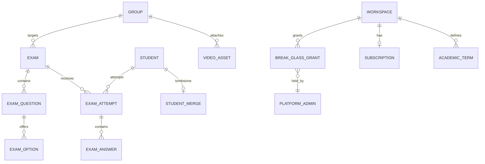

# Kashkol — Data Model

**Status:** Draft v0.1 · **Date:** 2026-10-21 · **Owner:** Engineering
**Companions:** `ARCHITECTURE.md`, `SECURITY_AND_PRIVACY.md`, `INTEGRATIONS.md`, `PRODUCT_REQUIREMENTS.md` §3

> The data model is the part of Kashkol that is **most expensive to change later**
> (`OPEN_QUESTIONS_AND_ASSUMPTIONS.md` §1 rule 3). Every table here maps to a decision (`D-n`), an
> assumption (`A-n`), or an acceptance criterion. Where the specification did not decide, the
> conservative default from `OPEN_QUESTIONS_AND_ASSUMPTIONS.md` is applied and marked.

---

## 1. Design rules

| # | Rule | Source | Enforcement |
|---|---|---|---|
| DM-1 | Every tenant-scoped table has a **non-null** `workspace_id`, an index on it, and RLS policies. | `F-P0-01` AC-1 | **[CI]** schema check + migration check |
| DM-2 | There is **no global student table** and no global group table. | `D-12`, `PRODUCT_REQUIREMENTS.md` §1.4 | **[CI]** the table registry has no unscoped entity tables |
| DM-3 | No stored aggregate. There is no `attendance_pct`, `quiz_avg`, `homework_completion`, `trend`, or `status` column on `student`. | `D-05`, `D-08`, `NF-1`, `DEF-08`, `DEF-09` | **[CI]** forbidden-column-name check |
| DM-4 | History is never destroyed. Attendance corrections append a revision; grade and follow-up corrections append audit/history events. Records are archived or cancelled, never deleted. Financial corrections are separate append-only adjustments; recorded payments are not voided or rewritten by the manual ledger. | `D-10`, `NF-13`, flow invariant 5 | No `ON DELETE CASCADE` on business records; only `ON DELETE RESTRICT` or `SET NULL` |
| DM-5 | Every mutating table has `created_at` and `updated_at` in UTC. | Flow invariant 1 | Schema convention |
| DM-6 | Money is stored as an integer of minor units (`amount_minor`) with an explicit `currency` column. `A-04` sets EGP only; the column exists so the multi-currency ban is explicit rather than implicit. | `A-04`, `F-P2-04` AC-8 | `CHECK (amount_minor > 0)` |
| DM-7 | A phone number is stored **only** in E.164 form (`+20…`). The national form is never persisted. | `F-P1-10` AC-5, `R-06`, `DEF-01` | Normalisation in `students`/`parents` services; a test asserts the stored value |
| DM-8 | Timestamps that represent a **wall-clock moment in the teacher's day** are stored as a UTC instant **plus** the workspace timezone for display. A session has `starts_at` (timestamptz) and the workspace carries `timezone`. Naive local dates are never stored. | `A-03`, `F-P1-05` AC-7, `DEF-02` | Column type is `timestamptz`; a test asserts no `date`/`timestamp without tz` column exists on a time-bearing table |
| DM-9 | Enumerations are PostgreSQL `enum` types, not free text. Attendance marks are exactly four. | `D-04` | Enum type + `CHECK` |
| DM-10 | A soft-delete is expressed as `archived_at timestamptz` (or `deleted_at` for a workspace). "Not present" is always `archived_at IS NULL`. | `OQ-10` default (a) | Query helpers always filter `archived_at IS NULL` unless the caller asks otherwise |
| DM-11 | Identifiers are UUIDv7-style random UUIDs generated by the application, so they are not sequential and not guessable. | Security | Prisma `@default(uuid())`; ids never appear in a URL that grants access |
| DM-12 | Teacher-authored free text is stored as entered, untranslated, un-normalised. Arabic diacritics are preserved byte-for-byte. | `OQ-15` default (a), `F-P1-03` AC-7 | `text` columns; no normalisation function is applied on write |

---

## 2. Conventions

| Convention | Rule |
|---|---|
| Table names | Plural, `snake_case`: `workspace_member`, `attendance_mark` |
| Column names | `snake_case` |
| Primary key | `id uuid primary key` |
| Foreign keys | `<singular>_id`, referencing the singular table name |
| Enums | `snake_case` values, e.g. `at_risk`, `not_submitted` |
| Boolean | `is_` / `has_` / `was_` prefix, never a bare verb |
| Time | `*_at` for instants (`created_at`, `archived_at`), `*_on` for calendar dates (`paid_on`) |
| Soft delete | `archived_at`, `deleted_at`, `voided_at`, `revoked_at`, `cancelled_at` — the verb tells the story |
| JSON | Only for genuinely open-ended payloads: `diff`, `metadata`, `settings`, `payload`. Never for a field that should be a column. |

---

## 3. Entity relationship — core (M0–M2)

```mermaid
erDiagram
    USER ||--o| USER_PREFERENCE : has
    USER ||--o{ WORKSPACE_MEMBER : joins
    WORKSPACE ||--o{ WORKSPACE_MEMBER : has
    WORKSPACE ||--|| WORKSPACE_SETTINGS : configures
    WORKSPACE_MEMBER ||--o{ PERMISSION_GRANT : holds

    WORKSPACE ||--o{ SUBJECT : owns
    WORKSPACE ||--o{ GROUP : owns
    SUBJECT ||--o{ GROUP : classifies
    GROUP ||--o{ GROUP_SCHEDULE_SLOT : meets
    GROUP ||--o{ ENROLLMENT : contains
    STUDENT ||--o{ ENROLLMENT : enrolled
    WORKSPACE ||--o{ STUDENT : owns
    GROUP |o--o{ TEACHING_SESSION : schedules
    TEACHING_SESSION ||--o{ SESSION_ATTENDEE : rosters
    STUDENT ||--o{ SESSION_ATTENDEE : attends
    TEACHING_SESSION ||--o{ SESSION_REVISION : revised
    TEACHING_SESSION ||--o{ ATTENDANCE_MARK : records
    STUDENT ||--o{ ATTENDANCE_MARK : receives
    ATTENDANCE_MARK ||--o{ ATTENDANCE_REVISION : revises

    GROUP ||--o{ HOMEWORK : assigns
    HOMEWORK ||--o{ HOMEWORK_SUBMISSION : collects
    STUDENT ||--o{ HOMEWORK_SUBMISSION : submits

    GROUP ||--o{ ASSESSMENT : sets
    ASSESSMENT ||--o{ ASSESSMENT_SCORE : grades
    STUDENT ||--o{ ASSESSMENT_SCORE : earns

    STUDENT ||--o{ PAYMENT : pays
    STUDENT ||--o{ PAYMENT_ADJUSTMENT : adjusted
    PAYMENT ||--o{ PAYMENT_ADJUSTMENT : corrected
    STUDENT ||--o{ FEE_RULE : charged_by
    GROUP ||--o{ FEE_RULE : charged_by

    STUDENT ||--o{ MESSAGE_DRAFT : about
    GROUP ||--o{ MESSAGE_DRAFT : announces
    WORKSPACE ||--o{ FILE : stores
    FILE ||--o{ HOMEWORK : attached_to

    USER ||--o{ NOTIFICATION : receives
    WORKSPACE ||--o{ AUDIT_EVENT : records
    WORKSPACE ||--o{ OUTBOX_EVENT : queues
    WORKSPACE ||--o{ JOB : runs
    WORKSPACE ||--o{ PORTAL_GRANT : issues
    PORTAL_GRANT }o--|| STUDENT : links
    USER ||--o| PORTAL_LOGIN : authenticates
    PORTAL_LOGIN ||--o| PORTAL_GRANT : links
    WORKSPACE ||--o{ ATTENDANCE_TOKEN : mints
    WORKSPACE ||--o{ ONBOARDING_TASK : tracks
    WORKSPACE ||--o{ DELETION_REQUEST : schedules
    STUDENT ||--o{ FOLLOW_UP : followed
```



## 4. Entity relationship — reserved for P3

These tables are **not** created in M0/M1. They are listed so the naming and boundary conventions
are settled before anyone writes a migration.



---

## 5. Table reference

Only the columns that carry a rule are listed. `id`, `created_at`, `updated_at`, and `workspace_id`
are present on every tenant table by convention (`DM-1`, `DM-5`).

### 5.1 Identity and tenancy

#### `user` (Better Auth owned)

| Column | Type | Notes |
|---|---|---|
| `id` | uuid | PK |
| `name` | text | Personal name |
| `email` | text unique | |
| `email_verified` | boolean | |
| `image` | text nullable | |

Better Auth owns this table and the `session`, `account`, and `verification` tables. Kashkol does
not add columns to them; profile extensions live in `user_preference` and `workspace_member`.

#### `user_preference`

| Column | Type | Notes |
|---|---|---|
| `user_id` | uuid | PK, FK → `user` |
| `locale` | `locale` enum | `ar` (default) / `en` — `D-01` |
| `theme` | `theme` enum | `light` / `dark` / `system` — `D-02`, `A-13` |

Per-user, not per-workspace, so a person keeps their preferences when they switch workspace in M2.
`F-P3-03`/`F-P0-03`/`F-P0-04` are satisfied here.

#### `session_activity` (identity support, not tenant-scoped)

| Column | Type | Notes |
|---|---|---|
| `session_id` | text | PK, FK → `session` on delete cascade |
| `last_seen_at` | timestamptz | Updated at most once a minute by the session guard |

The table exists because the 12-hour idle timeout (`F-P0-02` AC-4) cannot be derived from Better
Auth's sliding `expiresIn`/`updateAge` alone. It adds no column to the Better Auth-owned `session`
table.

#### `auth_event` (security log, not tenant-scoped)

| Column | Type | Notes |
|---|---|---|
| `user_id` | text nullable | No foreign key: the event must survive account deletion |
| `identifier_hash` | text nullable | Keyed HMAC of the email; the email is never stored |
| `event` | text | `auth.signed_in`, `auth.sign_in_failed`, `auth.password_reset`, … |
| `ip_hash` | text nullable | Keyed HMAC of the client address |
| `user_agent_hash` | text nullable | Keyed HMAC |
| `request_id` | text | Correlates with logs |
| `created_at` | timestamptz | |

The application role has `SELECT, INSERT` only. No email address, raw IP, session token, password,
or reset link is written to this table or to `audit_event`.

#### `workspace`

| Column | Type | Notes |
|---|---|---|
| `name` | text | Workspace display name |
| `slug` | text unique | Used for URLs; not a security boundary |
| `teaching_name` | text | Shown in the dashboard greeting (`DEF-15` fixes the hardcoded name) |
| `primary_subject` | text nullable | |
| `grades_taught` | text[] | |
| `status` | `workspace_status` enum | `active` / `suspended` / `deleted` |
| `deleted_at` | timestamptz nullable | 30-day recovery window — `A-14` |

#### `workspace_settings` (one row per workspace)

| Column | Type | Notes |
|---|---|---|
| `workspace_id` | uuid | PK, FK |
| `at_risk_after` | int | Default `2`; `CHECK (at_risk_after >= 1 AND at_risk_after < inactive_after AND inactive_after <= 10)` — `F-P0-06` AC-5 |
| `inactive_after` | int | Default `4` |
| `locale` | `locale` enum | Default `ar` |
| `theme` | `theme` enum | Default `system` |
| `timezone` | text | Default `Africa/Cairo` — `A-03` |
| `currency` | text | Default `EGP` — `A-04` |
| `email_digest_enabled` | boolean | Default false; M2 opt-in — `F-P2-07` AC-4 |

#### `workspace_member`

| Column | Type | Notes |
|---|---|---|
| `workspace_id` | uuid | FK |
| `user_id` | uuid | FK |
| `role` | `member_role` enum | `owner` / `assistant` — `F-P2-01` |
| `status` | `member_status` enum | `active` / `invited` / `removed` |
| `joined_at` | timestamptz | |
| `removed_at` | timestamptz nullable | Removing a member revokes their sessions immediately — `F-P2-01` AC-6 |

`UNIQUE (workspace_id, user_id)`.

#### `permission_grant`

| Column | Type | Notes |
|---|---|---|
| `workspace_id` | uuid | FK |
| `member_id` | uuid | FK → `workspace_member` |
| `resource` | `permission_resource` enum | `students`, `grades`, `attendance`, `homework`, `files`, `messages`, `payments`, `settings`, `team`, `audit` — `F-P2-01` AC-2 |
| `action` | `permission_action` enum | `read` / `write` |

`UNIQUE (member_id, resource, action)`. An owner has **no rows** here and instead short-circuits on
role — there is no implicit "all permissions" row to get wrong.

### 5.2 Teaching content

#### `subject`

`id`, `workspace_id`, `name`, `search_key`, `phonetic_key`, `archived_at`. A subject is a
workspace-level label used to group groups; it is not a global taxonomy. The two derived search
columns are maintained by a trigger and indexed with `pg_trgm` GIN indexes; the stored `name` is
never normalised on write (`DM-12`).

#### `group`

| Column | Type | Notes |
|---|---|---|
| `workspace_id` | uuid | FK |
| `subject_id` | uuid nullable | FK |
| `name` | text | Not unique; duplicates show a "same name" hint — `F4` |
| `grade` | text nullable | |
| `color` | text | Key from the fixed accessible palette — `F-P1-04` AC-8 |
| `teacher_note` | text nullable | |
| `archived_at` | timestamptz nullable | Archived groups keep history — `F-P1-04` AC-6 |

A group has **no** schedule, room, or capacity columns. Each of those belongs to a meeting, not to
the group: a group meets one or more times a week and may use a different room or capacity per
meeting (`ADR-0029`). The legacy `weekday`, `start_time`, `end_time`, `room`, and `capacity` columns
were dropped after their values were copied into `group_schedule_slot`.

#### `group_schedule_slot`

| Column | Type | Notes |
|---|---|---|
| `workspace_id` | uuid | FK |
| `group_id` | uuid | FK |
| `weekday` | int | `0..6` where `0 = Saturday` — `A-02` |
| `start_time` | `time` | Local wall-clock in the workspace timezone |
| `end_time` | `time` nullable | |
| `room` | text nullable | Room for **this** meeting |
| `capacity` | int nullable | Optional maximum roster size; `1..500` when present |

One row per weekly meeting; a group may have several (`ADR-0029`). Sessions are generated per slot,
so a group with two slots produces two sessions per week. The overlap warning (`F-P1-04` AC-7)
compares slots across the workspace and remains a warning, not a block.

`weekday` is an integer rather than a Postgres `DOW` so that `0 = Saturday` matches the product's
week order and the calendar UI. The conversion is a single helper, `weekdayToDate()`, and is
unit-tested against `A-02`.

#### `enrollment`

| Column | Type | Notes |
|---|---|---|
| `workspace_id` | uuid | FK |
| `group_id` | uuid | FK |
| `student_id` | uuid | FK |
| `enrolled_at` | timestamptz | |
| `left_at` | timestamptz nullable | A student removed from a group keeps their records but leaves the denominator — `F11` |

A student may be enrolled in many groups (`D-07`). `UNIQUE (group_id, student_id, enrolled_at)` is
not used; instead a partial unique index prevents two open enrolments for the same pair.

#### `student`

| Column | Type | Notes |
|---|---|---|
| `workspace_id` | uuid | FK |
| `first_name` | text | Required — `F-P1-02` AC-4 |
| `last_name` | text | Required |
| `grade` | text nullable | |
| `phone_e164` | text nullable | E.164 only — `DM-7` |
| `parent_name` | text nullable | |
| `parent_phone_e164` | text nullable | E.164 only |
| `joined_at` | timestamptz | |
| `archived_at` | timestamptz nullable | Soft delete — `OQ-10` |
| `merged_into_id` | uuid nullable | Self-reference; the tombstone for `F-P3-08` AC-4 |
| `search_key` | text nullable | Derived by trigger: `normalize_arabic(first_name || ' ' || last_name)` |
| `phonetic_key` | text nullable | Derived by trigger: `phonetic_arabic(...)` |

**There is no `status` column, no `consecutive_absences` column, and no `attendance_pct` column.**
Status and streak are derived (§7). A cache column may be added later, but it must be named
`*_cache` and must never be read as truth — the M1 truthfulness audit recomputes from rows.

Unique constraints: `UNIQUE (workspace_id, phone_e164)` where `phone_e164 IS NOT NULL`, to support
the import match rule "name + phone within the workspace" (`F-P1-03` AC-2).

#### `student_note`

`workspace_id`, `student_id`, `body`, `author_id`, `created_at`. Notes are staff-only records,
append-only for the application role, and are excluded from audit diffs and portal projections
(`F7`, `NF-7`).

#### `teaching_session`

| Column | Type | Notes |
|---|---|---|
| `workspace_id` | uuid | FK |
| `group_id` | uuid nullable | FK; null for a grade-level or independent session — `ADR-0029` |
| `grade_label` | text nullable | Free-text grade for a grade-level session; null otherwise |
| `starts_at` | timestamptz | UTC instant — `DM-8` |
| `ends_at` | timestamptz nullable | |
| `status` | `session_status` enum | `scheduled` / `started` / `completed` / `cancelled` |
| `is_one_off` | boolean | True for a session created outside the weekly slots — `F-P1-05` AC-6 |
| `room` | text nullable | |
| `location` | text nullable | |
| `notes` | text nullable | |
| `cancelled_at` | timestamptz nullable | |
| `cancelled_by` | uuid nullable | |

A session is one of three modes (`ADR-0029`):

| Mode | `group_id` | `grade_label` | Roster |
|---|---|---|---|
| Group | set | null | The group's active `enrollment` rows |
| Grade-level | null | set | Snapshot in `session_attendee` at creation (origin `grade`) |
| Independent | null | null | `session_attendee` rows added by hand (origin `manual`) |

`group_id` and `grade_label` are mutually exclusive and enforced by the shared Zod schema and the
service. Only a session with `group_id` takes part in the group conflict check. A grade-level
roster is a **snapshot**, not a live query: later enrollments do not move it, and the teacher edits
it explicitly (`A-22`).

Cancelled sessions are excluded from attendance denominators (`F-P1-05` AC-5) and are never deleted
(`F1` error table: "sessions are cancelled, never deleted"). `completed` is a status marker, not a
write lock: attendance and corrections remain allowed on any non-cancelled session (`ADR-0029`).

#### `session_attendee`

| Column | Type | Notes |
|---|---|---|
| `workspace_id` | uuid | FK |
| `session_id` | uuid | FK |
| `student_id` | uuid | FK |
| `origin` | `session_attendee_origin` enum | `grade` (snapshot at creation) or `manual` (teacher added) |

The materialised roster of a **group-less** session (`ADR-0029`). Group sessions do not use it: their
roster is the group's enrollments. `UNIQUE (workspace_id, session_id, student_id)` prevents a
duplicate attendee; the composite tenant foreign keys use `ON DELETE RESTRICT`. A student on this
table may be marked; a student who is not cannot. Removing an attendee who already has an
`attendance_mark` is refused, so no recorded mark is discarded silently.

#### `session_revision`

| Column | Type | Notes |
|---|---|---|
| `session_id` | uuid | FK |
| `actor_id` | uuid | |
| `reason` | text nullable | Required when attendance already exists — `F-P2-12` AC-1 |
| `before` | jsonb | |
| `after` | jsonb | |

Append-only.

### 5.3 Attendance

#### `attendance_mark` (the current value)

| Column | Type | Notes |
|---|---|---|
| `workspace_id` | uuid | FK |
| `session_id` | uuid | FK |
| `student_id` | uuid | FK |
| `mark` | `attendance_mark` enum | `present` / `absent` / `late` / `excused` — `D-04` |
| `source` | `attendance_source` enum | `manual` / `qr` |
| `device_id` | text nullable | Present for QR — `F-P2-05` AC-5 |
| `recorded_by` | uuid | The actor |
| `recorded_at` | timestamptz | |

`UNIQUE (session_id, student_id)`. This table holds the **head** of the revision chain only.

#### `attendance_revision` (the immutable chain)

| Column | Type | Notes |
|---|---|---|
| `session_id` | uuid | FK |
| `student_id` | uuid | FK |
| `attendance_mark_id` | uuid | FK → `attendance_mark` |
| `old_mark` | `attendance_mark` nullable | Null for the first write |
| `new_mark` | `attendance_mark` | |
| `actor_id` | uuid | |
| `reason` | text nullable | |
| `batch_id` | uuid nullable | Groups a bulk correction — `F-P1-07` AC-4 |
| `created_at` | timestamptz | |

Append-only. Never updated, never deleted (`D-10`). A correction that restores the original value
still creates a revision — the audit trail shows the teacher considered and changed it
(`F9` error table).

#### `attendance_token` (P2)

`workspace_id`, `group_id`, `session_id`, `token_hash` (the plaintext is shown only at generation),
`expires_at` (default 30 min, max 4 h), `rotated_at`. Rotation supersedes the previous token
immediately — `F-P2-05` AC-7.

### 5.4 Homework and assessments

#### `homework`

`workspace_id`, nullable `group_id`, required `title`, nullable `instructions`, `due_at`
(timestamptz), nullable `max_score`, `status` (`active` / `archived`), `created_by`, and
`archived_at`. Group assignments create one `homework_submission` row for each active enrolment;
selected-student assignments use the same per-student rows with a null group. Enrolling a student
later in a group assignment creates their row through the homework module's public API.

#### `homework_submission`

| Column | Type | Notes |
|---|---|---|
| `workspace_id` | uuid | Tenant FK |
| `homework_id` | uuid | Tenant-composite FK |
| `student_id` | uuid | Tenant-composite FK |
| `status` | `homework_submission_status` enum | `not_submitted` / `submitted` / `late` / `excused` |
| `teacher_feedback` | text nullable | Staff-only feedback |
| `score` | numeric(6,2) nullable | Optional grade, bounded by the homework maximum |
| `submitted_at` | timestamptz nullable | Manual teacher record; no online upload is implemented |
| `updated_by` | text | Staff actor |

`UNIQUE (homework_id, student_id)`. Status and optional grade/feedback are per-student facts. Online
file submission remains unavailable until the student-portal submission flow is implemented; the
teacher may only record a submission manually.

#### `homework_completion_mark` (offline yes/no)

| Column | Type | Notes |
|---|---|---|
| `workspace_id` / `homework_id` | uuid | Tenant-composite FKs |
| `student_id` | uuid | Tenant-composite FK |
| `session_id` | uuid nullable | Link to the session attendance screen that asked; null when written in bulk without a session |
| `status` | `homework_completion_status` enum | `completed` / `not_completed` / `not_applicable` |
| `note` | text nullable | Staff-only |
| `recorded_by` | text | Staff actor |

`UNIQUE (homework_id, student_id)`. This is the teacher's one-tap offline answer to "did they do the
homework". It is upserted (never appended-only), never defaulted to a claimed done answer: a missing
mark means **not recorded** everywhere it is surfaced. The session attendance screen writes one linked
to `session_id`; bulk assignment writes rows without one. The same helper
`getSessionHomeworkContextTx` reads all marks linked to a roster.

#### `homework_resource`

`workspace_id`, `homework_id`, `file_id`; composite tenant FKs bind the assignment and file to the
same workspace. Only existing clean files that are permitted for all assigned students may be linked.

#### `assessment`

| Column | Type | Notes |
|---|---|---|
| `workspace_id` / `group_id` | uuid | Tenant and group |
| `title` | text | Required |
| `type` | `assessment_type` enum | `paper_exam` / `quiz` / `test` / `other` |
| `note` | text nullable | Staff-only |
| `date` | `date` | Calendar date |
| `max_score` | numeric(6,2) | Default 100 |
| `extra_credit_allowance` | numeric(6,2) nullable | Additional points above maximum; null disables it |
| `locked_at` | timestamptz nullable | Marks are final |
| `unlock_reason` | text nullable | Required when unlocking |

#### `assessment_score`

| Column | Type | Notes |
|---|---|---|
| `workspace_id` / `assessment_id` / `student_id` | uuid | Tenant-composite FKs |
| `score` | numeric(6,2) nullable | Required only when status is `graded` |
| `status` | `assessment_result_status` enum | `graded` / `missing` / `excused` / `not_taken` |
| `note` | text nullable | Staff-only |
| `updated_by` | text | Staff actor |

`UNIQUE (assessment_id, student_id)`. A graded score is constrained to `0..max_score` plus the
assessment's optional extra-credit allowance by service validation and database triggers. A score
correction is recorded in the same transaction in the append-only audit log; an idempotent repeat
does not create another event.

Assessment percentages are `score / max_score * 100`; an average is the arithmetic mean of graded
percentages. Missing, excused, and not-taken results are excluded, not treated as zero. Group summary
and per-student trend/history are computed from tenant-scoped source rows.

### 5.5 Student follow-up

#### `student_follow_up`

`workspace_id`, `student_id`, active `owner_user_id`, `title`, private nullable `note`, optional
`due_at`, `status` (`open` / `resolved`), optional `outcome`, `resolved_at`, and `created_by`.
Records remain available for history; they are not parent-facing.

#### `student_follow_up_event`

Append-only task history with workspace/task identifiers, actor user id and display-name snapshot,
action, optional outcome, and creation time. Task mutations and matching audit events are written in
the same scoped transaction.

Computed flag rules expose their source record ids and dates: the configured `at_risk_after`
consecutive-absence threshold (default 2) within one group; homework still `not_submitted` after its
due instant; and a lower average across the latest three graded assessment percentages than the
preceding three. Flags are derived, not stored, and their source categories are permission-filtered.
These current thresholds are deterministic; a complete workspace rule editor remains follow-up
scope, not an implemented capability.

### 5.6 Money

#### `payment`

| Column | Type | Notes |
|---|---|---|
| `workspace_id`, `student_id` | uuid | Composite tenant-scoped FKs; `student_id` is **nullable** (ADR-0028) |
| `session_id` | uuid nullable FK to `teaching_session` | A receipt usually references the session it was collected for; the CHECK constraint `payment_session_required_check` requires at least one of `student_id` / `session_id` |
| `period` | text nullable | e.g. `2026-10` — the period covered |
| `amount_minor` | int | Positive piastres; input is a decimal string and conversion uses integer math |
| `currency` | text | Explicit on every amount; EGP only for this stage |
| `method`, `method_label` | enum, nullable text | `cash` / `transfer` / `other`; custom label required for `other` |
| `paid_on` | `date` | Date the teacher recorded as paid |
| `purpose`, `reference_number`, `note` | nullable text | Purpose, optional receipt reference, and optional note |
| `idempotency_key` | text, nullable | Unique per workspace; exact retries do not duplicate records |
| `created_by` | text | Authenticated operator |
| `voided_at`, `void_reason` | nullable | Legacy fields; the current ledger does not update payments to void them |

#### `payment_revision`

The legacy revision table remains in the core schema but is not used by the manual ledger. Payment
rows are append-only and cannot be amended or deleted.

#### `fee_rule`

An append-only **group-only** monthly convention: `amount_minor`, `effective_from`, `purpose`, and
`created_by`. The `student_id` column remains for reading historical rows only; new rules are
created against a group (`ADR-0028`). No invoice, tax, or accounting records are created.

#### `payment_adjustment`

An append-only record with nullable `student_id`, optional `payment_id`, `kind` (`discount`,
`refund`, `correction`), positive `amount_minor`, signed `balance_impact`, `paid_on`, required
`reason`, `idempotency_key`, and `created_by`. A refund tied to a receipt cannot exceed its
remaining refundable amount. The adjustment and audit event are written in one transaction.

Money is **session-scoped** (`ADR-0028`): expected revenue is computed as session price × the
number of present/late marks for non-cancelled sessions, and collected revenue as the sum of
session-linked non-voided receipts (§7.5). There is **no stored balance** and no per-student
outstanding figure. Monthly/group fee rules do not accrue per-student balances; they remain a
group-level convention only.

### 5.7 Messaging

#### `message_draft`

| Column | Type | Notes |
|---|---|---|
| `workspace_id` | uuid | FK |
| `type` | `message_type` enum | `attendance_update`, `homework_reminder`, `assessment_result`, `progress_report`, `group_announcement`, `custom` |
| `student_id` | uuid nullable | Null for a group announcement |
| `group_id` | uuid nullable | |
| `body` | text | The prepared text |
| `phone_used` | text nullable | The E.164 number the link was built with |
| `state` | `message_state` enum | `prepared` / `opened_in_whatsapp` |
| `prepared_at` | timestamptz | |
| `opened_at` | timestamptz nullable | |

**There is no `sent_at`, `delivered_at`, or `read_at` column.** The enum has no such members, so
the database itself cannot represent a delivery claim (`NF-2`, `D-16`). The UI label is "Open in
WhatsApp"; the recorded state is "opened in WhatsApp".

The draft body is **rebuilt from the record at open time**, not frozen — the stored `body` is the
text as prepared, and the link is generated from live data when the teacher opens it
(`F-P1-10` AC-8).

### 5.8 Files

#### `file`

| Column | Type | Notes |
|---|---|---|
| `workspace_id` | uuid | FK |
| `scope` | `file_scope` enum | `teacher_only` / `groups` / `students` |
| `group_id` | uuid nullable | Legacy primary target, migrated to `file_group_access` |
| `student_id` | uuid nullable | Legacy primary target, migrated to `file_student_access` |
| `title` | text | Safe display title; never used as a path |
| `description` | text nullable | Optional teacher-authored description |
| `subject_id` | uuid nullable | Composite workspace FK to `subject` |
| `topic` | text nullable | Optional topic label |
| `storage_key` | text unique | `ws/{workspace_id}/{uuid}.{ext}` — never contains the filename |
| `size_bytes` | int | ≤ 25 MB — `A-09` |
| `mime` | text | |
| `scan_status` | `scan_status` enum | `pending` / `clean` / `blocked` |
| `uploaded_by` | uuid | Uploader/owner |
| `archived_at` | timestamptz nullable | Hides the file from active lists and all portal access; retains object |
| `deleted_at` | timestamptz nullable | Soft-delete marker set before the storage object is removed |

#### `file_group_access` and `file_student_access`

Each table has a composite primary key containing `workspace_id`, `file_id`, and its target id.
Composite foreign keys ensure that the material and target belong to the same workspace. Both tables
have RLS policies and workspace indexes. Multiple targets are explicit rows, not JSON.

### 5.9 Platform records

#### `notification`

`workspace_id`, `recipient_user_id`, `type`, `severity` (`info` / `warning` / `critical`),
`entity_type`, `entity_id`, `message_key` (locale-independent catalogue key — never a rendered
string), `read_at`, `dedupe_key` (cooldown suppression), `created_at`.

`UNIQUE (recipient_user_id, dedupe_key)` where `dedupe_key` is not null.

#### `audit_event`

See `ARCHITECTURE.md` §11 for the full column list and rules.

#### `outbox_event`

`workspace_id` (nullable for platform-level work), `kind`, `payload` jsonb, `state`
(`pending` / `running` / `done` / `failed`), `attempts`, `run_at`, `locked_at`, `last_error`,
`created_at`.

Index: `(state, run_at)`.

#### `job`

A user-visible job record, distinct from `outbox_event` (which is internal machinery).
`workspace_id`, `kind` (`export`, `workspace_delete`, `storage_reconcile`, `email_digest`),
`status` (`queued` / `running` / `ready` / `failed`), `progress` int, `result` jsonb (expiring link
metadata), `error` text, `requested_by`, `created_at`, `updated_at`.

#### `report_export` and `report_export_queue`

`report_export` stores the tenant, report type, validated query/filter snapshot, requester, filename,
status, storage key, and safe failure code. The queue holds only job/workspace ids plus retry/lock
state. The unique `(workspace_id, id)` constraint supports a tenant-composite queue FK. Report data
is reloaded through the tenant-scoped repository when the worker processes the request.

#### `portal_grant` (M2)

`workspace_id`, `portal_user_id` (a `user` row used for portal sessions), `student_id`,
nullable `guardian_id` (composite FK to `student_guardian`), `kind` (`parent` / `student`),
`permissions` jsonb (`showAttendance`, `showGrades`, `showHomework`, `showResources`,
`showSchedule`, `showNotifications` — **no financial permission**; ADR-0028 removed `showPayments`),
`issued_by`, `issued_at`, `expires_at`,
`revoked_at`. Enforces tenant isolation RLS plus `portal_grant_self_read` (`portal_user_id = current_user_id()`).

#### `portal_invitation` (M2)

`workspace_id`, `student_id`, nullable `guardian_id`, `kind` (`parent` / `student`),
`invited_email` (normalised lower-case), `token_hash` (SHA-256 of the high-entropy secret; raw token is never stored),
`permissions` jsonb, `expires_at`, `accepted_at`, `accepted_by_user_id`, `revoked_at`, `created_by`.
Accepting an invitation verifies that the signed-in user's verified email matches `invited_email`
and atomically creates/updates the `portal_grant` row in the same transaction.

#### `portal_login` (M2, teacher-generated credentials)

Global identity table, **not** tenant-scoped and deliberately without RLS: sign-in resolves the
account by phone before any workspace is known. `portal_user_id` (a Better Auth `user` row whose
synthetic email is `student-<id>@students.kashkol.invalid`, always `email_verified = true`),
`username_phone` (E.164-normalised; **not** unique — a phone may name one credential per workspace),
`status` (`active` / `disabled`), `password_set_at`, `created_at`, `updated_at`. The paired Better Auth
`account` row (`provider_id = 'credential'`, `account_id = user.id`) stores the password as a scrypt hash;
the plaintext is returned once, in the issuing request only. A `portal_login` row is created only inside
the same transaction as a `portal_grant` (`kind = 'student'`) for that workspace, so the tenant link and
the credential can never exist without each other. Disabling the login flips `status` to `disabled`,
deletes the credential's sessions, and invalidates any active sessions; re-enabling restores `active`
but never revives a revoked grant. Audit events `portal.credential.*` are written in the same
transaction. The `portal_access` permission resource (`read` / `write`) gates every credential view and
mutation; assistants receive no grant by default. Migration header note: `20261112000000_student_portal_credentials`
cites `F-P3-01` by mistake — the feature serves `F-P2-03` / `F18`.

#### `portal_push_subscription` (M2)

`workspace_id`, `user_id`, `portal_kind` (`parent` / `student`), `endpoint`, `p256dh_key`,
`auth_key`, `include_sensitive_details` (default `false` for lock-screen privacy), `user_agent`,
`revoked_at`. Enforces both `workspace_id = current_workspace_id()` and `user_id = current_user_id()`
under forced RLS.

#### `follow_up` (M2)

`workspace_id`, `student_id`, `channel` (`call` / `whatsapp` / `in_person`), `followed_up_on`
(date), `outcome`, `note`, `created_by`, `created_at`.

#### `attention_flag` (M2)

`workspace_id`, `student_id`, `kind`, `opened_at`, `resolved_at` nullable, `resolved_by` nullable,
`resolution_note` nullable.

The **flag** is persisted because a teacher can resolve it; the **reasons** are always recomputed
from records, so a flag never goes stale — it is reopened automatically when the underlying
condition returns (`F21` error table).

#### `onboarding_task` (M0)

`workspace_id`, `key` (`teaching_name`, `grades`, `first_group`, `first_students`), `completed_at`
nullable. The checklist is server-side so it survives devices (`F1` step 7).

#### `deletion_request` (M0 scaffold, executed in M2)

`workspace_id`, `requested_by`, `confirmed_at`, `state` (`requested` / `running` / `completed` /
`failed`), `scheduled_purge_at` (30 days — `A-14`), `completed_at`, `error`.

### 5.10 P3 tables (`20261101120000_p3_videos_and_online_exams` & reserved)

| Table | Purpose |
|---|---|
| `video_lesson`, `video_group_access`, `video_student_access` | **Implemented (`F-P3-02`)** — Provider (`cloudflare_stream` / `fake`), `external_asset_id`, title, description, subject/topic, `publication_status` (`draft` / `published` / `archived`), `asset_status` (`pending_upload` / `processing` / `ready` / `failed`), `duration_seconds`, `size_bytes`, `playback_count`, `estimated_bandwidth_bytes`, and composite tenant-scoped group/student access joins under forced RLS |
| `online_exam`, `online_exam_student_assignment`, `online_exam_question` | **Implemented (`F-P3-01`)** — Online exam & quiz authoring (`draft` → `published` → `closed` → `archived`), availability window (`available_from`, `available_until`, `duration_minutes`), `max_attempts`, `result_visibility` (`after_manual_publish` / `immediate_after_submit` / `after_window_close`), linked `assessment_id` for gradebook synchronization, and structured questions (`mcq_single`, `true_false`, `short_answer`, `essay`) under forced RLS |
| `online_exam_attempt`, `online_exam_response` | **Implemented (`F-P3-01`)** — Authenticated student attempts (`in_progress` → `submitted` → `graded`, or `in_progress` → `expired` when the deadline passes without submission; expired attempts still count toward `max_attempts`), `auto_score`, `manual_score`, `total_score`, per-question answers, deterministic evaluation, and teacher feedback under forced RLS |
| `break_glass_grant` | Reserved — Ticket reference, reason, actor, expiry (default 1 h) |
| `platform_admin`, `platform_audit_event` | Reserved — Platform operators and their own log |
| `subscription` | Reserved — Plan, state, provider ids — webhook-driven |
| `academic_term` | Reserved — Start/end dates per workspace and grade |
| `student_merge` | Reserved — Merge record with both original ids (the tombstone on `student.merged_into_id` is the row) |

### 5.11 Forms tables (`20261104120000_forms_foundation`, `20261106120000_forms_public_lifecycle`, `F-P3-09`, `F-P3-12`)

| Table | Purpose |
|---|---|
| `form` | Tenant-owned form definition: `title`, `description`, `status` (`draft` / `published` / `archived`), `submission_mode` (`identified` / `anonymous`), `is_public`, unique nullable `public_slug`, `accepting_responses`, `confirmation_message`, `settings_json`, `created_by_user_id`, and `published_at` / `archived_at` timestamps |
| `form_section` | Ordered section/page of a form: `title`, `description`, `order_index`, and `page_break_before`. Unique `(form_id, order_index)` |
| `form_question` | Ordered question in a form or section: `question_type` (11 supported types), `prompt`, `description`, `is_required`, and type-specific `config_json`. Unique `(form_id, order_index)`; a null `section_id` places the question before any section |
| `form_question_option` | Ordered choice label for `multiple_choice`, `checkboxes`, and `dropdown`. Unique `(question_id, order_index)` |
| `form_question_logic` | Conditional rule: source question, `operator`, nullable `comparison_json`, `action` (`show` / `hide` / `require`), and exactly one target (`target_question_id` or `target_section_id`) enforced by a check constraint |
| `form_submission` | One response: `submission_mode`, optional `student_id` and `submitted_by_user_id` (both null for anonymous), optional `submission_token` (UUID) and `dedupe_key` (opaque 8–128 character client string) for idempotent retries, `submitted_at`, and `archived_at`. No stored aggregate. Unique `(form_id, submission_token)` and `(form_id, dedupe_key)` |
| `form_answer` | One stored answer per `(submission_id, question_id)`, with a validated `value_json`. File ids are not duplicated here |
| `form_answer_file` | Join between a file-upload answer and an existing `file` row in the same workspace. Composite primary key `(workspace_id, answer_id, file_id)`; no separate file store |
| `form_upload` | Provenance for a respondent file uploaded through the public route: `workspace_id`, `form_id`, `question_id`, `file_id`, and `upload_session_hash` (SHA-256 of the server-issued capability token, never the token itself). Unique `(workspace_id, file_id)`; the submission path accepts a claimed file only when its form, question, and upload-session hash all match |

Public respondent files are `file` rows with `scope = 'form_upload'` and no group or student target;
the `file_scope_check` constraint allows exactly that combination. `form_upload` carries forced row-level
security and four tenant foreign keys to `workspace`, `form`, `form_question`, and `file`.

Every table has a non-null `workspace_id`, a composite tenant foreign key, an index on `workspace_id`,
and forced row-level security. A submission with an identity mismatch against its form's mode is
rejected, and an answer to a hidden conditional question is discarded rather than stored. The data
model deliberately adds **no** parallel student or user table.


---

## 6. Tenancy enforcement in the schema

Every tenant table gets the same block. This is the **only** sanctioned way to create one.

```sql
ALTER TABLE "student" ENABLE ROW LEVEL SECURITY;
ALTER TABLE "student" FORCE  ROW LEVEL SECURITY;

CREATE POLICY "student_tenant_isolation" ON "student"
  USING      (workspace_id = current_setting('app.workspace_id', true)::uuid)
  WITH CHECK (workspace_id = current_setting('app.workspace_id', true)::uuid);
```

`current_setting('app.workspace_id', true)` returns `NULL` when the setting is absent, so a query
outside a scoped transaction matches **no rows** rather than all rows. `FORCE` applies the policy
even to the table owner, and the application role does not have `BYPASSRLS`.

The setting is applied per transaction, not per connection:

```sql
SELECT set_config('app.workspace_id', $1, true);   -- true => transaction-local
```

Because the setting is transaction-local, a pooled connection cannot carry one tenant's scope into
another request.

**Tenant table registry.** The registry is the explicit list of tenant tables, used by the CI check,
the isolation-matrix generator, and the export job. It is a single module
(`src/lib/db/tenant-tables.ts`) that exports the table names, and the CI check asserts that the
registry, the Prisma schema, and the database agree.

---

## 7. Derived values — the queries

These are the definitions the application uses. They are the SQL, not a description of the SQL, so
that the truthfulness audit can compare them against the UI.

### 7.1 Attendance rate for a student

```sql
SELECT
  count(*) FILTER (WHERE m.mark IN ('present','late'))::numeric
  / NULLIF(count(*) FILTER (WHERE m.mark IN ('present','late','absent')), 0)
    AS attendance_rate
FROM attendance_mark m
JOIN teaching_session s ON s.id = m.session_id
WHERE m.workspace_id = $1
  AND m.student_id   = $2
  AND s.status <> 'cancelled'
  AND EXISTS (
    SELECT 1 FROM enrollment e
    WHERE e.student_id = m.student_id
      AND e.group_id   = s.group_id
      AND e.enrolled_at <= s.starts_at
      AND (e.left_at IS NULL OR e.left_at >= s.starts_at)
  );
```

`excused` appears in neither the numerator nor the denominator (`D-06`, `A-05`). A `NULL` result
means "no denominator" and renders as `—`, never `0`.

### 7.2 Consecutive absences and derived status

The streak is the length of the trailing run of `absent` marks in the student's session history,
ordered by session start. `excused` and **unrecorded** sessions both break the run — a student who
was not marked is not absent (`F-P1-06` AC-9).

```
streak >= inactive_after  -> inactive
streak >= at_risk_after   -> at_risk
otherwise                 -> active
```

The thresholds come from `workspace_settings` at read time, so changing a threshold takes effect
immediately and the F-P0-06 AC-6 "recomputation" is automatic.

### 7.3 Homework completion

```sql
SELECT
  count(*) FILTER (WHERE status = 'submitted')::numeric
  / NULLIF(count(*), 0) AS completion_rate
FROM homework_submission
WHERE workspace_id = $1 AND homework_id = $2;
```

Students who left the group keep their record but are excluded from the denominator
(`F11` error table), which is applied by the same enrolment predicate as §7.1.

### 7.4 Assessment average

```sql
SELECT avg(score / max_score) FROM assessment_score
JOIN assessment USING (assessment_id)
WHERE workspace_id = $1 AND student_id = $2 AND score IS NOT NULL;
```

Ungraded assessments are excluded, never counted as zero (`F-P1-09` AC-5).

### 7.5 Session revenue

```sql
expected_piastre
= price_per_student_minor
  × count(attendance_mark) FILTER (WHERE mark IN ('present', 'late'))
WHERE workspace_id = $1 AND session_id = $2 AND session.status != 'cancelled';

collected_piastre
= COALESCE(sum(p.amount_minor) FILTER (WHERE p.voided_at IS NULL), 0)
WHERE workspace_id = $1 AND p.session_id = $2;
```

The ledger's headline total nets refunds from gross receipts
(`collected = gross − Σ refund adjustments`); the per-session summary shows gross
non-voided receipts for that session. Adjustments remain append-only and signed.

Session revenue is **computed**, never stored. Expected revenue is derived from the session's
`price_per_student_minor` (or the group's `default_price_per_student_minor`) and its present/late
marks. Collected revenue is the sum of session-linked receipts. There is deliberately **no**
outstanding/credit figure: the product does not compute a per-student or per-session balance, and
no screen displays one (`ADR-0028`).

---

## 8. Index strategy

| Table | Index | Purpose |
|---|---|---|
| Every tenant table | `(workspace_id)` | Mandatory — `DM-1` |
| `student` | `(workspace_id, archived_at)`, `(workspace_id, phone_e164)` unique where not null | List filter, import match |
| `enrollment` | `(group_id, student_id)` where `left_at IS NULL`, `(student_id)` | Roster, student's groups |
| `teaching_session` | `(group_id, starts_at)`, `(workspace_id, starts_at)` | Week view, date range |
| `attendance_mark` | `(session_id, student_id)` unique | Idempotent attendance save |
| `attendance_revision` | `(attendance_mark_id, created_at)` | History chain |
| `homework_submission` | `(homework_id, status)` | Completion rate |
| `assessment` | `(workspace_id, date)` | Assessment history |
| `assessment_score` | `(assessment_id, student_id)` unique, `(student_id)` | Grade entry and student history |
| `homework_resource` | `(workspace_id)` | Tenant-scoped permitted resources |
| `student_follow_up` | `(workspace_id, status, due_at)` | Open tasks and due-date queue |
| `student_follow_up_event` | `(follow_up_id, created_at)` | Ordered task history |
| `payment` | `(workspace_id, session_id)` partial where `session_id IS NOT NULL`, `(student_id, period)` (legacy), `(workspace_id, voided_at)` | Session receipts, legacy rows |
| `payment_adjustment` | `(workspace_id, paid_on)`, `(workspace_id, student_id, paid_on)` (legacy), unique `(workspace_id, idempotency_key)` | Adjustment history and safe retries |
| `fee_rule` | `(workspace_id, student_id, effective_from)`, `(workspace_id, group_id, effective_from)` | Effective fee convention lookup |
| `report_export` | `(workspace_id, created_at)` | Tenant-scoped export history |
| `report_export_queue` | `(status, created_at)` | Bounded worker polling |
| `file` | `(scope, group_id)`, `(scope, student_id)`, `(workspace_id, scan_status)` | Visibility queries, scan reconciliation |
| `audit_event` | `(workspace_id, created_at desc)`, `(entity_type, entity_id)`, `(actor_user_id, created_at)` | Activity Log filters |
| `notification` | `(recipient_user_id, read_at)`, `(recipient_user_id, dedupe_key)` unique where not null | Unread count, cooldown |
| `outbox_event` | `(state, run_at)` | Worker poll |
| `message_draft` | `(workspace_id, created_at desc)` | Prepared-messages list |
| `portal_grant` | `(workspace_id, student_id, kind, revoked_at)`, `(portal_user_id, revoked_at)` | Active portal links per student and per portal user |
| `portal_login` | `portal_user_id` unique, `(username_phone)` | Sign-in candidate lookup by phone (bounded scan; password disambiguates) |
| `portal_invitation` | `token_hash` unique, `(workspace_id, student_id, kind)`, `(workspace_id, invited_email)` | Single-use token lookup and student portal-access listing |
| `portal_push_subscription` | `(workspace_id, user_id, endpoint)` unique, `(workspace_id, user_id, revoked_at)` | Active Web Push device subscriptions per portal user |

Full-text search for `F-P1-13` is a **M1 scope decision** (`OQ-07` default (b): students + groups).
Case-insensitive and diacritic-insensitive matching over Arabic names uses `ILIKE` with a
normalised, indexed copy of the name (`search_key`) that folds Arabic-Indic digits and strips
tatweel — deliberately conservative, matching `OQ-07` and the `F-P1-13` AC-2 wording.

The implemented SQL, in migration `20261024130000_core_domain`, adds:

| Function | Purpose |
|---|---|
| `normalize_arabic(text)` | Lower-cases, strips tatweel and diacritics, folds Arabic-Indic digits to ASCII, unifies `أإآٱ → ا`, `ى → ي`, `ة → ه`, `ؤ → و`, `ئ → ي`, and collapses whitespace |
| `phonetic_arabic(text)` | Applies `normalize_arabic` then folds commonly interchanged consonants (`ع→ا`, `ح/خ→ه`, `ط→ت`, `ص→س`, `ض/ظ/ذ→د`, `ث→س`) |
| `current_workspace_id()` | Safe `nullif(current_setting('app.workspace_id', true), '')::uuid` for every RLS policy |

`student.search_key`, `student.phonetic_key`, `subject.search_key`, `subject.phonetic_key`,
`group.search_key`, and `group.phonetic_key` are trigger-maintained. Each has a
`GIN (… gin_trgm_ops)` index. The phonetic key is a search aid, not a stored truth: two distinct
names may share a key and the real spelling is always displayed. `pg_trgm` is created by the
migration; the deploying role must be allowed to install the extension.

---

## 9. Retention and deletion

| Data | Rule | Source |
|---|---|---|
| Business records (students, attendance, grades, payments) | Retained for the workspace lifetime; never hard-deleted | `OQ-10` (a) |
| Workspace deletion | Soft-deleted for 30 days, then hard-deleted from the database, then objects removed within a further 30 days | `A-14` |
| Backups | 35-day cycle; the logical encrypted archive is swept at 35 days (`BACKUP_RETENTION_DAYS`), and Railway managed backups are planned on a 35-day cycle (unverified) | `A-14`, `F-P0-09` AC-3; `docs/OPERATIONS_RUNBOOK.md` |
| Audit events | Retained for the workspace lifetime; the `OQ-18` default aggregates after 24 months for workspace-scoped views, but the underlying rows are retained | `OQ-18`, `F-P0-07` AC-6 |
| IP addresses / device ids | 90-day retention, redacted from user-visible views | `PRODUCT_REQUIREMENTS.md` §9 |
| Session cookies / tokens | Rotated on privilege change; never logged | §9 |
| File objects | Removed within a bounded window after deletion, verified by `storage.reconcile` | `F-P0-08` AC-5 |
| Notification records | 12 months | House rule; not specified, recorded here to avoid drift |

The hard-delete path is a **job**, not a request handler: it runs in the background, records its
state in `deletion_request`, and is idempotent on retry (`F-P1-14` AC-4, `F-P0-08` AC-3).

---

## 10. M0 migration sequence

The order matters, because later migrations reference earlier tables and the RLS policies must
exist before any data is written.

| # | Migration | Contents |
|---|---|---|
| 1 | `0001_extensions` | `pgcrypto`, `citext` if needed |
| 2 | `0002_enums` | All enum types, including homework status, assessment type/result status, follow-up status/outcome, and the existing identity, attendance, payment, messaging, file, and notification enums |
| 3 | `0003_identity` | Better Auth tables: `user`, `session`, `account`, `verification` |
| 4 | `0004_tenancy` | `workspace`, `workspace_settings`, `workspace_member`, `permission_grant`, `user_preference`, `onboarding_task`, `deletion_request` |
| 5 | `0005_teaching` | `subject`, `student`, `group`, `enrollment` |
| 6 | `0006_scheduling` | `teaching_session`, `session_revision` |
| 7 | `0007_attendance` | `attendance_mark`, `attendance_revision`, `attendance_token` |
| 8 | `0008_homework` | `homework`, `homework_submission` |
| 9 | `0009_assessments` | `assessment`, `assessment_score` |
| 10 | `0010_messaging` | `message_draft` |
| 11 | `0011_files` | `file` |
| 12 | `0012_payments` | `payment`, `payment_revision` |
| 13 | `0013_platform` | `audit_event`, `notification`, `outbox_event`, `job` |
| 14 | `0014_rls` | RLS policies for every tenant table + the `current_setting` helper + revoking `UPDATE`/`DELETE` on `audit_event` from the application role |
| 15 | `0015_indexes` | The indexes in §8 |
| 16 | `0016_checks` | `CHECK` constraints, including the forbidden-column assertion and the `student` unique phone constraint |

**Every tenant-table migration includes its `workspace_id` column, index, and RLS policy in the
same migration** (`ARCHITECTURE.md` §19 rule 5). Migration 14 exists for tables whose policies
depend on later tables only as a safety net; it must be empty if rule 5 was followed.

**Implemented migrations (through 2026-11-14).** The repository currently applies the sequence in a
consolidated form rather than one directory per row above:

| Migration | Contents |
|---|---|
| `20261023063122_init` | Better Auth tables, user preference, workspaces, members, grants, onboarding, audit, RLS, and the threshold check |
| `20261023080000_scope_permission_grants` | Composite grant/member foreign key and the additional member uniqueness |
| `20261024120000_auth_tenancy_portals` | `rate_limit`, `student`, `portal_grant`, RLS, and the portal-link composite foreign key |
| `20261024130000_core_domain` | Enums, `session_activity`, `auth_event`, the core domain tables, Arabic search functions and triggers, GIN indexes, checks, RLS, the safe `current_workspace_id()` helper, and append-only revision grants |
| `20261024131000_rate_limit_text_id` | Changes `rate_limit.id` from UUID to TEXT because Better Auth generates an opaque id |
| `20261025100000_student_notes_and_group_capacity` | Adds teacher-only `student_note` rows (with RLS and foreign keys) and the `group.capacity` column |
| `20261025110000_session_revision` | Audited session correction history |
| `20261028000000_attendance_tokens` | Tenant-scoped attendance tokens and forced RLS |
| `20261028100000_messaging_notifications` | Tenant-scoped messaging, notification, and outbox records |
| `20261029120000_academic_records` | Homework, per-student submissions/resources, assessment result details and constraints, follow-up tasks/events, audit support, and forced RLS |
| `20261029141000_learning_materials` | Tenant-scoped file records, target joins, storage metadata, and forced RLS |
| `20261029150000_manual_payment_ledger` | Append-only fee rules and adjustments, integer-piastre payment metadata, idempotency, and financial RLS |
| `20261029160000_report_exports` | Asynchronous tenant-scoped export jobs and queue |
| `20261030120000_team_invitations` | Team invitations, workspace-settings conventions, and forced RLS |
| `20261031120000_parent_student_portals_pwa` | Parent and student portal grants (`guardian_id`, `permissions`), verified `portal_invitation` tokens, `portal_push_subscription` Web Push records, and forced RLS |
| `20261101120000_p3_videos_and_online_exams` | Recorded video lessons (`video_lesson`, `video_lesson_group`, `video_lesson_student`, `video_playback_grant`), online exams (`online_exam`, `online_exam_student`, `online_exam_question`, `online_exam_attempt`, `online_exam_response`), and forced RLS (`F-P3-01`, `F-P3-02`) |
| `20261101140000_p3_platform_admin_and_plans` | Centralized workspace plan/status columns (`plan_tier`, `plan_status`, `plan_limit_overrides`, `status_reason`), global `platform_admin` and append-only `platform_audit_event` tables, tenant-scoped `break_glass_grant` with forced RLS, and platform-admin workspace read policy |
| `20261104120000_forms_foundation` | Form definitions, sections, questions, options, conditional logic, submissions, answers, and answer-file joins, with forced RLS (`F-P3-09`) |
| `20261106120000_forms_public_lifecycle` | Public form read policy keyed by `app.public_form_id`, `form_upload` provenance, and submission idempotency columns (`F-P3-12`) |
| `20261107120000_forms_public_rls_and_schema_reconcile` | Forces RLS on `form_upload`, adds its four tenant foreign keys and lookup indexes, changes `dedupe_key` to TEXT, replaces the global submission indexes with form-scoped ones, drops the unused `file.form_uploads` column, and grants the application role write access to `form_upload` |
| `20261107121000_forms_file_scope_enum` | Adds `form_upload` to the `file_scope` enum |
| `20261107122000_forms_file_scope_check` | Extends `file_scope_check` so a `form_upload` file must have null group and student targets |
| `20261107130000_session_status_started` | Adds `started` to the `session_status` enum |
| `20261107131000_teaching_session_schedule_fields` | Adds `room`, `location`, `notes`, `teacher_id`, `assistant_id`, `series_id`, `occurrence_no`, `started_at`, and `completed_at` to `teaching_session`, plus its `series_id` index |
| `20261108000000_session_pricing` | Adds `default_price_per_student_minor` to `group`, `price_per_student_minor` to `teaching_session`, and `session_id` to `payment` |
| `20261108000001_attendance_payment_verification` | Adds `payment_verified` boolean to `attendance_mark` (removed again by `20261113000002_session_scoped_finance`, ADR-0028) |
| `20261108000002_cross_season_attendance` | Adds `is_cross_season` boolean and `primary_group_id` foreign key to `attendance_mark` |
| `20261108000003_student_qr_identity` | Adds `qr_token_hash` persistent identity token hash to `student` |
| `20261112000000_student_portal_credentials` | Adds `portal_login_status` enum, the global `portal_login` identity table, the `portal_access` permission resource, and application-role grants; no tenant link is stored on it (`F-P2-03` / `F18`) |
| `20261113000000_drop_portal_login_qr` | Drops `portal_login.qr_token_hash` and `portal_login.qr_token_expires_at`; the portal-sign-in prefill QR is removed (`ADR-0027`) |
| `20261108000004_homework_completion_marks` | Adds `homework_completion_status` enum and `homework_completion_mark` table with forced RLS and tenant indexes |
| `20261110000000_worker_workspace_enumeration` | Adds `list_active_workspace_ids_for_worker()` (`SECURITY DEFINER`, `STABLE`) returning the ids of active non-deleted workspaces only, never any other tenant field; `GRANT EXECUTE` to `kashkol_app` only (`ADR-0024`) |
| `20261111000000_expired_online_exam_attempt_status` | Adds `expired` to the `online_exam_attempt_status` enum (`F-P3-01`) |
| `20261113000001_homework_completion_mark_grants` | Adds `homework_completion_mark` grants and RLS policy support, and application-role grants (`ADR-0021`) |
| `20261113000002_session_scoped_finance` | `payment.student_id` and `payment_adjustment.student_id` become nullable; adds the `payment_session_required_check` CHECK constraint; drops `attendance_mark.payment_verified`; adds partial index `payment(workspace_id, session_id)` where `session_id IS NOT NULL` (`ADR-0028`) |
| `20261113000003_group_schedule_slots` | Adds `group_schedule_slot` (weekday, start/end time, room, capacity) with forced RLS, grants, and its tenant indexes; copies each group's former weekday/start/end into one slot; drops `group.weekday`, `group.start_time`, `group.end_time` (`ADR-0029`) |
| `20261113000004_group_slot_drop_legacy_columns` | Drops `group.room` and `group.capacity`; room and capacity now live on `group_schedule_slot` (`ADR-0029`) |
| `20261114000000_session_attendee` | `teaching_session.group_id` becomes nullable and `grade_label` is added; adds the `session_attendee_origin` enum and `session_attendee` table with composite tenant foreign keys, forced RLS, and application-role grants (`ADR-0029`) |

The current local development database tracks all thirty-eight migrations above. `student` and
`subject`/`group` carry the derived search columns described in §8.

---

## 11. Data integrity checks

Run in CI and after every production migration.

| Check | Assertion |
|---|---|
| Tenant table completeness | Every table in the registry has `workspace_id`, an index, and an RLS policy |
| No unscoped entity table | No table named `student`, `group`, `attendance_mark`, `payment`, `file` lacks `workspace_id` |
| Forbidden columns | No column matches `attendance_pct`, `quiz_avg`, `homework_completion`, `trend`, `status` on `student` |
| No naive timestamps | No `timestamp without time zone` column on a time-bearing table |
| Envelope integrity | Every `attendance_mark` has exactly one head row and an ordered revision chain |
| Money integrity | Every `payment.amount_minor > 0`; `currency` is always populated |
| Phone integrity | Every `phone_e164` matches `^\+[1-9]\d{6,14}$` |
| No delivery claims | The `message_state` enum has no member matching `sent`, `delivered`, or `read` |
| Audit integrity | `audit_event` rows exist for every mutating service path exercised by the test suite |
| Isolation | The generated cross-tenant matrix passes |

---

## 12. Known data-model risks

| ID | Risk | Mitigation |
|---|---|---|
| DMR-1 | The `student` table grows a `status_cache` column for list filtering and it becomes truth | The column is named `*_cache`, the truthfulness audit recomputes from rows, and `DM-3` forbids unprefixed names |
| DMR-2 | `workspace_member.role` grows beyond `owner`/`assistant` and the grant model becomes ambiguous | Roles stay coarse; granularity always lives in `permission_grant` |
| DMR-3 | `message_draft.body` is stored and later contradicts the live record | The link is rebuilt from live records at open time; the stored body is the prepared text, and the UI shows the live preview |
| DMR-4 | Arabic search behaves badly without normalisation | A normalised `search_key` column; a deliberate, conservative fold (`OQ-07`) |
| DMR-5 | RLS transaction-per-read hurts list performance | Measured in M0 against the 1,000-student fixture before the M1 gate; the fallback is documented in `ARCHITECTURE.md` §23 AR-3 |
| DMR-6 | `deletion_request` hard-deletes audit rows that a legal hold requires | The audit retention window is a parameter of the deletion job, not a hard-coded constant; the legal review owns the value |
