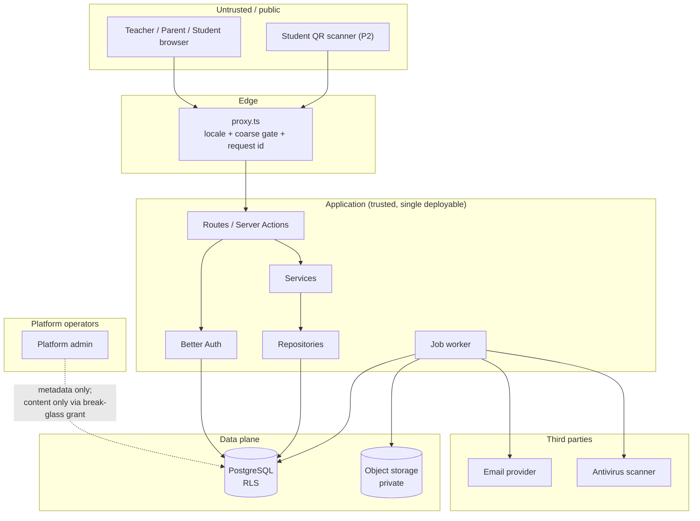

# Kashkol — Security and Privacy

**Status:** Draft v0.1 · **Date:** 2026-10-21 · **Owner:** Engineering (with Product for the privacy positions)
**Companions:** `ARCHITECTURE.md`, `DATA_MODEL.md`, `INTEGRATIONS.md`, `PRODUCT_REQUIREMENTS.md` §9–§12

> Kashkol holds the personal data of **minors** and the financial records of their families. The
> security posture is therefore not a feature tier — it is a precondition of shipping. Every control
> in this document is either enforced in code, enforced by a CI check, or verified by a named test.

---

## 1. Security objectives

| # | Objective | Consequence of failure |
|---|---|---|
| S-1 | One workspace can never see another workspace's data | Loss of the product's core trust claim (`R-01`, `NF-9`) |
| S-2 | A session cannot be stolen, replayed, or extended beyond its stated limits | Account takeover of a teacher account holding minors' data |
| S-3 | The platform cannot read tenant content without an audited, time-boxed, human-granted exception | Breach of the operator/tenant trust boundary (`A-12`, `D-13`) |
| S-4 | No credential, session token, or personal datum reaches a log, an analytics event, an error report, or a client bundle | Uncontrolled disclosure |
| S-5 | Every mutation is reconstructable: who, what, when, before, after | The product's own promise to the teacher (`F-P0-07`) |
| S-6 | The teacher can take their data out, and can have it erased | Portability and privacy rights (`F-P0-08`) |
| S-7 | Nothing in the system claims a capability it does not have | A product that lies (`NF-1`, `NF-2`, `NF-11`) |

---

## 2. Threat model

### 2.1 Assets

| Asset | Sensitivity | Where it lives |
|---|---|---|
| Teacher account credentials and sessions | Secret | `user`, `session`, `account`; password hashes with a memory-hard KDF |
| Student names, grades, phone numbers | Personal (minor) | `student` |
| Parent names, phones | Personal | `student.parent_*` |
| Attendance records | Sensitive (can imply health or family circumstance) | `attendance_mark`, `attendance_revision` |
| Assessment scores | Sensitive | `assessment_score` |
| Homework feedback and optional homework grades | Sensitive | `homework_submission` |
| Follow-up task notes and outcomes | Sensitive | `student_follow_up`, `student_follow_up_event` |
| Teacher notes | **Highly sensitive** — free text, may contain health or behaviour observations | `note` (a `student` sub-entity) |
| Files (worksheets, answer keys) | Confidential | `file` metadata plus private object storage; teacher-only answer keys are never shared |
| Payment records | Sensitive financial | `payment` |
| Message drafts | Personal | `message_draft` |
| Audit log | Sensitive | `audit_event` |
| Platform administrative credentials | Secret | Platform identity provider, not the tenant database |

### 2.2 Actors and trust boundaries



Trust boundaries that matter:

| Boundary | Crossing | Control |
|---|---|---|
| Browser → application | Any request | Authentication, authorisation, validation, tenant scope |
| Application → database | Every query | RLS + repository scoping (§2 of `DATA_MODEL.md`) |
| Application → storage | Download | Short-lived signed URL issued after a fresh authorisation check |
| Application → third party | Email; private scanner service | Server-side only, credentials never in the client; file bytes go only to private-network ClamAV |
| Platform operator → tenant data | Support access | Break-glass grant: ticket, reason, time-boxed, bannered in the tenant UI, audited |
| Tenant → tenant | Any cross-workspace attempt | `404`/`403`, never a row in the body |

### 2.3 Principal threats and mitigations

| Threat | Mitigation | Verification |
|---|---|---|
| Broken object-level authorisation (BOLA) on a tenant record | Session-derived scope + repository scoping + RLS; a foreign id returns `404` | Generated isolation matrix |
| Broken function-level authorisation | `authorize()` in every service, before any query | Generated permission matrix |
| Credential stuffing | Rate limiting (5 failed sign-ins / 15 min → lockout), breached-password list, generic error messages | Auth tests |
| Session theft via XSS | `HttpOnly` + `Secure` + `SameSite=Lax` cookies, `__Host-` prefix, no token in `localStorage` or a URL, strict CSP | Header assertions in tests |
| Session fixation | Server-side sessions; the session id is regenerated on sign-in | Auth test |
| Cross-site request forgery | `SameSite=Lax` cookies plus an origin check on every mutating request | CSRF test |
| SQL injection | Parameterised queries only; Prisma parameterises; no string-built SQL. The one deliberate raw statement (`set_config`) is parameterised | Lint rule banning template SQL **[CI]** |
| IDOR by guessing an id | UUIDv7 ids are not sequential; foreign ids return `404` | Isolation matrix |
| Path traversal in file upload | Storage key is server-generated (`ws/{workspace_id}/{uuid}.{ext}`); the client filename is never used as a path | Upload test |
| Malware in an uploaded file | Mandatory scan; not downloadable until clean; blocked files are visible but inert | Scan pipeline test |
| Arbitrary file read via signed URL | Signed URL issued only by an authorised route; the key is workspace-prefixed; expiry is short | Download authorisation test |
| Sensitive data in logs or error reports | Field allowlist per event type; a redaction test over a seeded fixture | Redaction test |
| Sensitive data in the client bundle | Server-only modules; `NEXT_PUBLIC_` used only for non-sensitive values; a bundle scan for known secret patterns | Bundle scan in CI **[CI]** |
| Secret leakage through the repository | Secret scanning in CI and in pre-commit; secrets live in the platform secret manager | Secret scan **[CI]** |
| Denial of service via the attendance write path | Payload limits, rate limits, bounded queries, transaction timeouts | Load test |
| Teacher-to-teacher harassment through support tooling | No bulk tenant export; break-glass is per-workspace, time-boxed, and bannered | Admin console test |
| Insider access to a workspace | Metadata-only console; every content read during a grant is logged and visible to the owner | Audit assertion |

---

## 3. Authentication and sessions

Implements `F-P0-02`.

### 3.1 Credentials

| Control | Setting |
|---|---|
| Minimum password length | 10 characters, enforced **server-side** (`F-P0-02` AC-1) |
| Breached-password check | The password is checked against a public breached-password list before the hash is stored |
| Hashing | Better Auth's default memory-hard KDF; the hash is never logged, never exported, and never in an audit diff |
| Registration | The email must be unique; the response is identical whether or not the account exists |
| Email verification | Required before the workspace is marked active; an unverified account can sign in only into the "verify your email" state (`F-P0-02` AC-2) |
| Verification link | Single use, 24 h validity, resend with a 60 s cooldown |
| Password reset | Single-use link, valid 30 minutes, invalidated on use (`F-P0-02` AC-8) |
| Lockout | 5 failed attempts per account per 15 minutes → temporary lockout with a **generic** message (`F-P0-02` AC-7) |
| Sign-up throttle | IP-based, enforced by the rate limiter |
| Enumeration | The "email not found" and "wrong password" responses are byte-identical |

### 3.2 Sessions

| Control | Value | Source |
|---|---|---|
| Storage | Server-side, in the database | `F-P0-02` AC-3 |
| Cookie | `HttpOnly`, `Secure`, `SameSite=Lax`, `__Host-` prefixed | `F-P0-02` AC-3, `F2` |
| Token location | Never in `localStorage`, never in a URL, never in a query string | `F-P0-02` AC-3 |
| Sliding expiry | 30 days of inactivity | `F-P0-02` AC-4 |
| Absolute expiry | 90 days from issue, regardless of activity | `F-P0-02` AC-4 |
| Idle timeout | 12 hours | `F-P0-02` AC-4 |
| Sign-out | Invalidates the session server-side immediately, then clears the cookie | `F-P0-02` AC-5 |
| Sign out everywhere | Invalidates every session for that user | `F-P0-02` AC-6 |
| Privilege change | Sessions are revoked when a member's permissions change or a member is removed | `F-P2-01` AC-6 |

**Configuration note.** Better Auth's defaults are a 7-day expiry with a 1-day refresh. Those
defaults **do not** satisfy `F-P0-02` AC-4 and must be overridden explicitly in `auth.ts`:
`session.expiresIn` (30 days), `session.updateAge` (the sliding refresh interval), and an
application-level idle check for the 12-hour timeout. The absolute 90-day cap and the
sign-out-everywhere path are enforced by the `identity` module. This is recorded as a risk in
`ARCHITECTURE.md` §23 (AR-4).

### 3.3 Rate limiting

Better Auth's built-in limiter is used, with the storage backed by the database so limits survive
restarts and multiple instances.

| Rule | Value |
|---|---|
| Global | 100 requests / 10 s, enabled in production |
| Sign-in | 3 requests / 10 s (library default), plus the **account-level** 5-per-15-minutes lockout from the product requirement |
| Sign-up | IP throttle |
| Password reset request | 3 requests / 10 s plus a 60 s per-address cooldown |
| Invitation resend | 1 per 60 s |

Behind a reverse proxy, the client IP is read from a **single trusted header** that the platform
sets, or from a configured trusted-proxy list. The forwarded-header chain is not trusted blindly,
because the leftmost token is client-controlled. Better Auth normalises IPv6 and rate-limits by
`/64` subnet by default, which is kept.

Rate-limit responses carry `X-Retry-After` and are surfaced in the UI as a retryable message.

### 3.4 Portal authentication (M2)

Parent and student sessions are separate session kinds from staff sessions.

| Aspect | Control |
|---|---|
| Linking | A teacher-issued single-use link or code, or a request the teacher approves (`OQ-02` default (a)) |
| Credential | An email link by default, with a teacher-issued code as the fallback (`OQ-09` default (c)+(d)) |
| OTP | If an SMS provider is contracted, OTP is rate-limited per number and per IP, with an attempt cap |
| Capability of the session | A portal session can never call a teacher endpoint; the route groups are separate and a shared guard rejects portal actors with `403` |
| Scope of the session | The set of linked student ids, resolved server-side on every request |
| Revocation | The owner revokes the grant; the next request fails with `401` |

An SMS provider is **not** required for M2 to ship (`RELEASE_PLAN.md` §9): the emailed-link path is
the default and the OTP path is an optional upgrade.

### 3.5 Student portal credentials (teacher-generated) — M2

Teacher-provisioned credentials let a student sign in at `/{locale}/portal` with their phone number
and a code the teacher generated. This replaces nothing: the invitation-link flow (`OQ-09`) is the
parent default and stays unchanged.

| Aspect | Control |
|---|---|
| Username | The student's phone number normalised to E.164 (`normalizePortalPhone`, Arabic-Indic digit aware). Two students **in one workspace** cannot share a phone (partial unique index `student_workspace_phone_unique`); the same phone across workspaces resolves each credential by password. |
| Password | `KSH-XXXX-XXXX` — 8 ambiguous-glyph-free characters from `[2-9A-HJKMNPQRSTUVWXYZ]`, drawn with `crypto.randomBytes`. Unguessable from the profile; unknown to the student until the teacher reads it out. |
| Storage | Better Auth `credential` `account` (synthetic, non-deliverable email `student-<id>@students.kashkol.invalid`, `email_verified = true`) storing the scrypt hash. No plaintext column exists anywhere. The issuing response carries the plaintext exactly once; it is never persisted, re-served, logged, or sent to any provider. |
| Delivery | The teacher reads the code from the screen during provisioning (one-time reveal). There is **no** automated delivery channel; WhatsApp/SMS delivery of the credential is out of scope. |
| Reset | No self-service reset exists for student credentials. Only regeneration by an actor holding `portal_access:write`. Regeneration replaces the hash and immediately invalidates the old password; all sessions of the credential user are revoked in the same transaction. |
| QR token | **Removed.** The `/{locale}/portal?t=<token>` prefill token was a QR used for portal sign-in and has been dropped (`ADR-0027`, migration `20261113000000_drop_portal_login_qr`). A student's QR code is now attendance identification only (`student.qr_token_hash`, HMAC-signed `kqr_v1.<studentId>.<nonce>.<signature>`, §3.5 note). |
| Phone change | Re-points `username_phone` for the existing credential; the old phone stops resolving to it. Changing the phone of a student with a credential requires `portal_access:write` (fail-closed `403` otherwise); removing the phone disables the credential, revokes sessions. |
| Authorization | A new sensitive resource `portal_access` (`read` / `write`). Assistants hold it only when explicitly granted (default deny); owners always pass. Credential metadata (username, status) requires `read`; provision/regenerate/enable/disable require `write`. |
| Sign-in | Real Better Auth session as the synthetic user. Application-level lockout: 5 failures per 15 minutes keyed on the hashed `portal:<phone>` namespace (`auth_event`), identifier hashed, on top of Better Auth's `/sign-in/email` limit (3 per 10s). Sign-in additionally requires an `active` `portal_login` and a non-revoked student `portal_grant`. The password alone selects the account among shared-phone candidates. |
| Session | A portal session can never call a teacher endpoint (unchanged, §3.4). Disabling or regenerating revokes all credential sessions via `deleteSessionsForUserTx` inside the same transaction. |
| Audit | `portal.credential.provisioned` / `regenerated` / `enabled` / `disabled` are written in the same transaction as the mutation, on the `audit_event` path with redaction. |
| Verify at test time | Hash/verify round-trip; one-time reveal is not re-served by any endpoint; regeneration invalidates the old password and its sessions; credential hashes are stored, plaintext never; assistant without the grant receives `403`; a disabled login rejects sign-in with a single generic error; the attendance QR identifies students but can never authenticate them. |

**Student attendance QR (separate from portal sign-in).** The student QR is attendance identification
only (`ADR-0027`). It is a signed opaque token `kqr_v1.<studentId>.<nonce>.<signature>` (HMAC-SHA256,
server-secret signed; signature and record hash verified on scan), generated with `crypto.randomBytes`
on student creation, stored hashed in `student.qr_token_hash` (per-workspace), and used exclusively by
the session attendance scan path (`scanStudentQrCode`). It **cannot** sign a student in, reset a
password, activate an account, or read private data — the scan path verifies the signature, looks up
the student within the workspace, and records attendance. It is revocable (revocation clears the hash),
regenerable (the previous identifier is invalidated immediately), rate-limited at the scan endpoint
(10 requests/minute per IP), and never encodes a password, hash, or personal data. QR scanning runs
through the same attendance authorization rules as manual marking: an assistant without
`attendance:write` receives `403`.

---

## 4. Authorisation and tenancy

The mechanisms are specified in `ARCHITECTURE.md` §8–§9 and `DATA_MODEL.md` §6. This section states
the security intent that drives them.

| # | Rule |
|---|---|
| T-1 | The workspace id is derived from the session. It is never accepted from a URL parameter, a body field, or a header the client controls. |
| T-2 | A resource that does not exist and a resource belonging to another workspace are **indistinguishable**: both return `404` with an identical body. |
| T-3 | Three independent layers enforce isolation (session scope, repository scoping, RLS). A defect in one layer is not sufficient to leak data. |
| T-4 | Permissions are deny-by-default. An assistant without a grant receives `403` from the API, not a hidden menu item. |
| T-5 | The owner role holds every permission, and this is enforced server-side rather than by disabling checkboxes. |
| T-6 | A parent can never see another child, a group aggregate, or a teacher note. Portal queries are scoped to the linked student ids and exclude `note` entirely. |
| T-7 | A student can never reach a teacher endpoint. |
| T-8 | A platform administrator sees operational metadata only. Content access requires a break-glass grant that is ticket-referenced, time-boxed (default 1 h), bannered in the tenant UI, and visible in the owner's Activity Log. There is no bulk tenant export. |

**File downloads** deserve a specific statement because signed URLs are a common leak vector. The
flow is: authorised request → server re-checks scope and permission → server issues a short-lived
signed URL for that exact object key → the browser fetches it directly from storage. The signed URL
is never issued for a key the caller is not entitled to, and a key is workspace-prefixed so a
workspace A cannot address a workspace B object even with a leaked URL.

---

## 5. Input validation and output encoding

| Layer | Control |
|---|---|
| Client | Zod schema shared with the server; the client result is advisory |
| Server (authoritative) | The same Zod schema, applied before any write |
| Database | `NOT NULL`, `CHECK`, `UNIQUE`, foreign keys, and enum types carry the invariants the application must not be able to violate |
| Output | React escapes by default; `dangerouslySetInnerHTML` is banned across the codebase **[CI]** |
| Markdown/rich text | Teacher-authored notes and message bodies are stored and rendered as **plain text**, not HTML. There is no rich-text renderer in M0/M1 |
| SQL | Prisma parameterises everything. The single raw statement (`set_config`) is a tagged template with a bound parameter |
| Headers | No user input is echoed into a response header |
| Redirects | Redirect targets are internal paths only; a supplied URL is rejected **[CI]** |

**File names** are sanitised for display (control characters removed, length capped) but the stored
name is never used as a filesystem path.

---

## 6. File handling security

| Control | Rule | Source |
|---|---|---|
| Storage | Private buckets. No public path, no public CDN, no `ACL: public-read`. | `A-09` |
| Key generation | Server-generated: `ws/{workspace_id}/{uuid}.{ext}` | `FS-3` in `ARCHITECTURE.md` |
| Size limit | 25 MB, enforced server-side | `A-09`, `F-P1-11` AC-2 |
| Type limit | PDF, PNG, JPG, DOCX, XLSX, PPTX. The declared MIME type and the file signature must both be checked — a renamed `.exe` is rejected. | `F-P1-11` AC-2 |
| Malware scan | Mandatory. `scan_status` must be `clean` before a download link is issued. | `F-P1-11` AC-3 |
| Scanning isolation | The application reads the private object and sends the bounded bytes over the private network to ClamAV. Content is never logged or served from the scanning buffer. | ADR-0017 |
| Archive bombs | DOCX/XLSX/PPTX central directories are checked for traversal, executable entries, entry-count, and expansion-ratio limits before ClamAV. | Hardening |
| PDF active content | PDFs are served with `Content-Disposition: attachment` unless rendered in the in-app viewer, which uses a sandboxed iframe with no script permission. | Hardening |
| Upload path | A multipart upload goes through an authorised route; the browser does not receive storage credentials. | Hardening |
| Visibility | Exactly three scopes: teacher-only, selected groups, and selected students. Portal access requires a live explicit parent/student grant and an assigned target. | `F-P1-11` |
| Retention | Delete revokes metadata access transactionally and removes the private object; bucket lifecycle rules are the backstop. | `F-P0-08` AC-5 |
| Sharing | No public share links. | `OQ-12` default (a) |

---

## 7. Secrets management

| Environment | Where secrets live |
|---|---|
| Local | `.env.local`, git-ignored, never committed |
| CI | CI secret store; masked in logs |
| Staging / production | Platform secret manager (Railway service variables) |

**Rules**

1. No secret is ever committed. CI runs a secret scanner and **fails the build** on a detection. **[CI]** (`F-P0-09` AC-6)
2. Secrets are read from `process.env` **server-side only**. A secret must never be prefixed with
   `NEXT_PUBLIC_`. A CI check fails if a known secret-shaped variable name appears with that
   prefix. **[CI]**
3. The database URL is split: a pooled URL for the application and a direct URL for migrations.
   Neither appears in a log; the logger redacts any value matching a URL pattern.
4. Third-party credentials (email, scanner, storage) are server-side only. A client bundle is
   scanned for the credential values in CI. **[CI]** (`F-P0-02` AC-10)
5. Key rotation is a documented runbook item; no credential is hard-coded in the repository.
6. `prisma.config.ts` imports `dotenv/config` because Prisma 7 no longer loads `.env` implicitly —
   an explicit, reviewable load path rather than a hidden one.

---

## 8. Logging, error tracking, and PII redaction

### 8.1 The redaction rule

`F-P0-08` AC-6 and `PRODUCT_REQUIREMENTS.md` §9 are strict: **logs, error reports, and analytics
never contain student names, phone numbers, note bodies, or message bodies.**

The implementation is an **allowlist per event type**, not a blocklist:

```ts
const FIELD_ALLOWLIST: Record<string, readonly string[]> = {
  "attendance.saved": ["sessionId", "markedCount", "durationMs"],
  "auth.signed_in":  ["userId", "outcome"],
  // …
};
```

Anything not on the list is dropped before serialisation. A blocklist would fail the first time
someone adds a field.

### 8.2 Rules

| # | Rule |
|---|---|
| L-1 | Structured JSON logs, one object per line, with `requestId`, `route`, `durationMs`, `level`. |
| L-2 | The actor is identified by `userId`, never by name. |
| L-3 | IP addresses are hashed and salted before logging; the raw IP is retained only in the auth audit for 90 days and is redacted from any user-visible view. |
| L-4 | Error reports carry a stack trace, a request id, and non-identifying context. Source maps are uploaded for the production build so a stack trace is readable. (`F-P0-09` AC-4) |
| L-5 | Analytics record **event names and counts only**. The payload schema is reviewed against this document before analytics is enabled (`RELEASE_PLAN.md` §3.4). |
| L-6 | Request/response bodies are never logged. A malformed body is logged as a length and an error code. |
| L-7 | A redaction test runs against a seeded fixture containing known student names, phones, note bodies, and message bodies, and asserts that none of them appear in the captured log output, error report, or analytics payload. **[TEST]** |
| L-8 | The audit log is **not** a log. It is a product record, tenant-visible, and is handled by the rules in §9. |

---

## 9. Audit log security

| Control | Rule |
|---|---|
| Immutability | Append-only. `UPDATE` and `DELETE` are revoked from the application role on `audit_event`. There is no API that mutates an audit row. (`F-P0-07` AC-2) |
| Atomicity | The audit row is written in the same transaction as the mutation. A fault-injection test asserts the mutation rolls back when the audit insert fails. (`NF-7`) |
| Actor snapshot | The actor's display name is snapshotted so a later rename does not rewrite history. |
| Redaction | Free-text bodies are excluded from the diff and referenced by id. Secrets, tokens, and file contents are never included. (`F-P0-07` AC-7) |
| Coverage | The required action list lives in one constant; CI asserts every action is produced by at least one service. (`F-P0-07` AC-3) |
| Visibility | Owner always; an assistant only with the `audit` read permission. (`OQ-18` default (a)) |
| Retention | Retained for the workspace lifetime, included in a workspace export, and purged only after the workspace deletion window. |
| Platform access | Break-glass reads are logged in a platform-level log **and** surface in the tenant's Activity Log. |

---

## 10. Privacy

### 10.1 Data minimisation

The system collects **only** what the teaching relationship requires:

**Collected:** teacher name and email; student first name, last name, grade, phone; parent name and
phone; attendance marks; homework submission status; assessment scores; teacher notes; group and
schedule data; files the teacher chooses to upload; message drafts the teacher prepares; session and
device metadata for security.

**Never collected** (`A-11`, `PRODUCT_REQUIREMENTS.md` §9): national ID, date of birth, biometrics,
precise location, religion, political affiliation, or any other sensitive-category data.

Each field in the schema has a stated purpose. A new field requires a purpose and a privacy note,
and the schema check fails the build for an undocumented column.

### 10.2 Retention

| Data | Retention | Source |
|---|---|---|
| Business records | Workspace lifetime | `OQ-10` (a) |
| Workspace soft-deletion | 30 days, recoverable by the owner | `A-14` |
| Hard deletion after soft deletion | Within a further 30 days | `A-14` |
| Backups | 35-day cycle | `A-14`, `F-P0-09` AC-3 |
| Audit events | Workspace lifetime; aggregated for the 24-month view window | `OQ-18` |
| IP addresses / device ids | 90 days | §9 of `PRODUCT_REQUIREMENTS.md` |
| Notifications | 12 months | House rule, `DATA_MODEL.md` §9 |
| Signed download URLs | Minutes | `FS-2` |

### 10.3 Data subject rights

| Right | Implementation | Requirement |
|---|---|---|
| Access / portability | A workspace export produces a machine-readable JSON archive including the audit log and the schema version. | `F-P0-08` AC-2, `F-P2-11` AC-1 |
| Erasure | A typed-confirmation request queues a deletion job with visible progress; it cascades to all child records and to stored objects. | `F-P0-08` AC-3/4, `F-P1-14` AC-4 |
| Export scoping | An export reads through the same tenant-scoped data layer, so it can never contain another workspace's rows. | `F-P2-10` AC-4 |
| Restore | Owner-only, pre-flight validated, executed as a background job, appending a "workspace restored" event rather than erasing history. | `F-P2-11` AC-2/4 |

**The deletion job is a job, not a request handler.** It is idempotent, records its state, and can
be retried without double-deleting.

### 10.4 Minors' data

Kashkol's users are Egyptian private teachers; the students are typically minors. This is the
highest-risk area of the product and is the reason for several hard constraints:

| Constraint | Reason |
|---|---|
| No national ID, no date of birth, no biometrics | Minimisation (`A-11`). It also makes parent/student linking possible without government identity checks (`OQ-02` (a), `OQ-03` (a)) |
| The teacher is the trust anchor for portal linking | The teacher knows the family; no third-party identity source is used |
| Teacher notes are highly sensitive and never exposed to a parent or student by default | `OQ-06` (a) |
| Group aggregates are hidden from the parent portal | A parent could otherwise infer other children |
| Audit and deletion are both implemented before M2 | Data held about minors must be exportable and erasable before third parties (parents) can access it |
| **Legal review is required and is not performed by engineering** | `F-P0-08` AC-7, `RELEASE_PLAN.md` §9, `R-12`. This document does **not** substitute for it. The privacy notice must exist in Arabic and English before P2 launch. |

---

## 11. Security controls matrix

One row per acceptance criterion that carries a security obligation.

| Requirement | Control | Verification |
|---|---|---|
| `F-P0-01` AC-1 | `workspace_id` + index + RLS on every tenant table | **[CI]** schema check + migration check |
| `F-P0-01` AC-2 | Session-derived scope; no client-supplied workspace id | **[TEST]** isolation matrix |
| `F-P0-01` AC-3 | Cross-tenant attempts return `404`/`403` with no row in the body | **[TEST]** generated matrix |
| `F-P0-01` AC-4 | Short-lived signed URLs bound to the owning workspace | **[TEST]** cross-workspace signed URL |
| `F-P0-01` AC-5 | Admin console is metadata-only; content via break-glass | **[TEST]** admin path assertions |
| `F-P0-01` AC-6 | Isolation suite runs on every build and blocks merge | **[CI]** |
| `F-P0-02` AC-1 | Password rules + breached-password check, server-side | **[TEST]** |
| `F-P0-02` AC-2 | Verification required before the workspace is active | **[TEST]** |
| `F-P0-02` AC-3 | `HttpOnly`/`Secure`/`SameSite=Lax` cookie; no token in `localStorage` or a URL | **[TEST]** header assertions + bundle scan |
| `F-P0-02` AC-4 | 30-day sliding, 90-day absolute, 12-hour idle | **[TEST]** session policy test |
| `F-P0-02` AC-5 | Sign-out invalidates server-side | **[TEST]** |
| `F-P0-02` AC-6 | Sign out everywhere invalidates all sessions | **[TEST]** |
| `F-P0-02` AC-7 | 5 failures / 15 min → lockout; IP throttle on sign-up | **[TEST]** |
| `F-P0-02` AC-8 | Single-use reset link, 30-minute validity | **[TEST]** |
| `F-P0-02` AC-9 | Every auth event audited with actor and IP | **[TEST]** audit assertion |
| `F-P0-02` AC-10 | No secret in a client bundle | **[CI]** bundle scan |
| `F-P0-07` AC-1/2/3 | Server-side audit, append-only, action coverage | **[TEST]** + **[CI]** |
| `F-P0-07` AC-7 | No secrets or free text in audit payloads | **[TEST]** redaction test |
| `F-P0-08` AC-1 | Data minimisation; no prohibited categories | **[CI]** schema column allowlist |
| `F-P0-08` AC-2 | Workspace export includes the audit log and a schema version | **[TEST]** |
| `F-P0-08` AC-3/4 | Deletion request → queued job → cascade → recorded | **[TEST]** |
| `F-P0-08` AC-5 | Object removal within a bounded window, verified by a job | **[TEST]** |
| `F-P0-08` AC-6 | No PII in logs, errors, analytics | **[TEST]** redaction test |
| `F-P0-08` AC-7 | Published privacy notice, Arabic and English, before P2 | **External:** legal review |
| `F-P0-09` AC-2 | Forward-only, versioned migrations with compensating migrations | **[CI]** |
| `F-P0-09` AC-3 | Automated backups + a monthly restore drill with a recorded result | **Operational** |
| `F-P0-09` AC-4 | Health checks, structured logs with a request id, error tracking with source maps | **[TEST]** |
| `F-P0-09` AC-6 | Secrets in a secret manager; CI fails on a detected secret | **[CI]** |
| `F-P1-06` AC-6 | One atomic transaction for a whole session's marks | **[TEST]** |
| `F-P1-11` AC-3 | Mandatory scan before download | **[TEST]** |
| `F-P2-01` AC-3/5 | Server-side permission enforcement; assistant cannot invite, alter the owner, delete the workspace, or change billing | **[TEST]** permission matrix |
| `F-P2-02` AC-5/6 | A parent sees only their own children; no group aggregates | **[TEST]** portal isolation |
| `F-P2-02` results projection | Parent grade access is limited to an explicitly authorized route and allowlisted fields for linked children; staff notes and follow-up data are excluded | **[TEST]** portal field-projection allowlist |
| `F-P2-05` AC-2/4 | Tokens stored hashed; expiry, rotation, session, and enrolment checked server-side | **[TEST]** |
| `F-P2-10` AC-4 | Exports read through the tenant-scoped layer | **[TEST]** two-workspace export assertion |
| `F-P3-03` AC-1..5 | Admin console metadata-only; break-glass time-boxed, bannered, audited | **[TEST]** |

---

## 12. Security testing

| Test class | Tool | Gate |
|---|---|---|
| Isolation matrix | Vitest, generated from the route registry | Blocks merge |
| Permission matrix | Vitest, generated | Blocks merge |
| Auth policy tests | Vitest | Blocks merge |
| Redaction test | Vitest | Blocks merge |
| Upload/scanner tests | Vitest | Blocks merge |
| Session/cookie assertions | Vitest | Blocks merge |
| Dependency audit | `npm audit` / equivalent | Blocks merge |
| Secret scan | CI secret scanner | Blocks merge |
| Bundle secret scan | CI | Blocks merge |
| Static analysis | ESLint rules (no `dangerouslySetInnerHTML`, no raw SQL, no `left`/`right` layout, no hardcoded colours) | Blocks merge |
| E2E security walkthrough | Playwright | Per release |
| **External penetration test** | A third party | **Before the public beta (M2) and before GA (M3)** — `RELEASE_PLAN.md` §6.3 |
| Security review | A second engineer | Before the private beta — `RELEASE_PLAN.md` §3.3 gate 8 |

---

## 13. Incident response

| Stage | Action | Timeframe |
|---|---|---|
| Detect | Alert on authentication anomalies, error-rate spikes, isolation-test failures, and unexpected bulk reads | Immediate |
| Contain | Revoke sessions; disable the affected feature flag; freeze writes for the affected module | Hours |
| Assess | Identify the scope: which workspaces, which records, which fields | Hours |
| Notify | The affected workspace owner is told what was accessed; the privacy notice's incident clause applies | As required by the legal review |
| Remediate | Fix, add a regression test that reproduces the leak, re-run the full matrix | Days |
| Record | A platform-level audit entry for every administrative action taken during the incident | Ongoing |

The break-glass mechanism is used during an incident only with a ticket, and every read is logged.

---

## 14. Known security risks and deferred items

| ID | Item | Status |
|---|---|---|
| SR-1 | Legal review of minors' data in Egypt | **Open and external.** Blocks the portals (`RELEASE_PLAN.md` §9). Not resolvable by engineering. |
| SR-2 | Data residency | `OQ-19` default (a): any region for build and beta, subject to the legal review. A residency change is a deployment change, not a code change. |
| SR-3 | SMS/OTP provider | Not required for M2; the emailed-link path is the default (`OQ-09`). |
| SR-4 | Antivirus scanner choice | Deferred to M1 implementation. If no scanner is available, the file feature ships **disabled** rather than unscanned (`RELEASE_PLAN.md` §9). |
| SR-5 | Rate-limit storage in the database | Slightly higher write volume than memory. Chosen because memory storage resets on restart and does not work across instances. |
| SR-6 | Better Auth session defaults do not match the product requirement | Overridden explicitly in `auth.ts`; covered by a session-policy test. |
| SR-7 | Penetration test | Scheduled before the public beta; not yet performed. |
| SR-8 | CSP strictness with the in-app PDF viewer | The viewer uses a sandboxed iframe; the CSP is tightened once the viewer ships. |

---

## 15. What an engineer must not do

These are the security-specific items on top of the general prohibitions in
`PRODUCT_REQUIREMENTS.md` §12.

1. Do not add a query that reads a tenant table without going through a repository function.
2. Do not accept a `workspace_id`, `role`, or `permission` value from the client.
3. Do not log a request body, a session token, a password, or a personal datum.
4. Do not render teacher-authored content as HTML.
5. Do not issue a signed URL without re-checking authorisation for that exact object.
6. Do not disable a failing isolation or permission test to make a branch merge.
7. Do not add a column to a tenant table without stating its purpose and its retention.
8. Do not store a raw IP address where a hash suffices.
9. Do not let a platform administrator read tenant content outside a break-glass grant.
10. Do not add a public-facing route that is not in the route registry, because the isolation matrix
    is generated from that registry.
